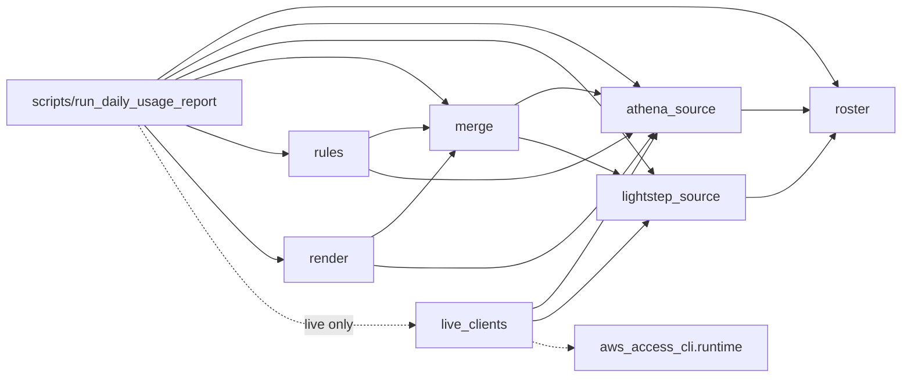

# Usage tracking — architecture after (UT-7)

Generated from the import graph of `src/pipelines/usage_tracking/` on 2026-11-04; production files only, tests excluded (`docs/refactor/architecture-diagrams.md`). Solid edges are imports; dashed
edges are imports that only run with a `--live-*` flag.

## Difference from the UT-1 plan

- New module `live_clients`: the single place concrete Athena and Lightstep clients are built, so the CLI and the sources stay free of them.
- `render` depends on `merge` and `athena_source` directly (the plan drew `render ← rules`); `rules` mutates nothing the renderer needs to import.
- `live_clients` imports `aws_access_cli.runtime` (`make_auth`, `make_athena_client`), a pipeline-to-pipeline edge. UT-1 proposed extracting those into `src/lib` as a follow-up; that follow-up is
  still open and is the only live-path dependency affected. The default (local) path has no such edge.
