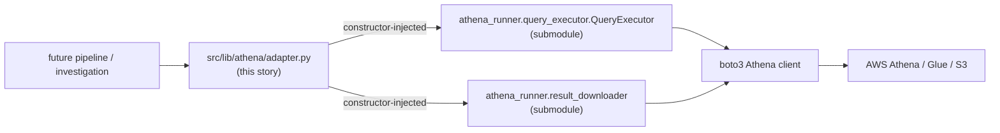
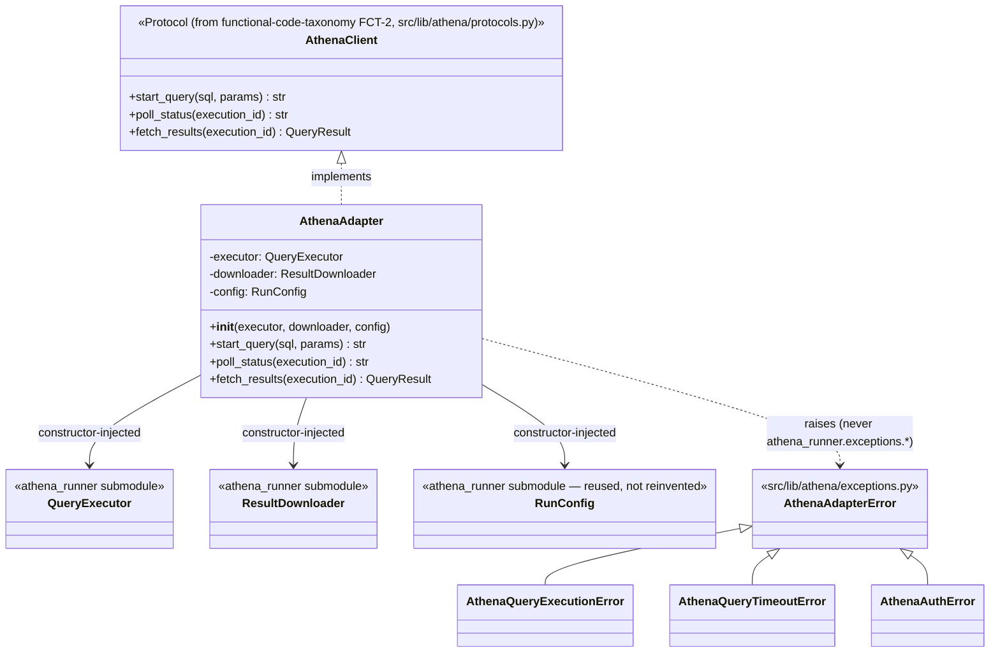
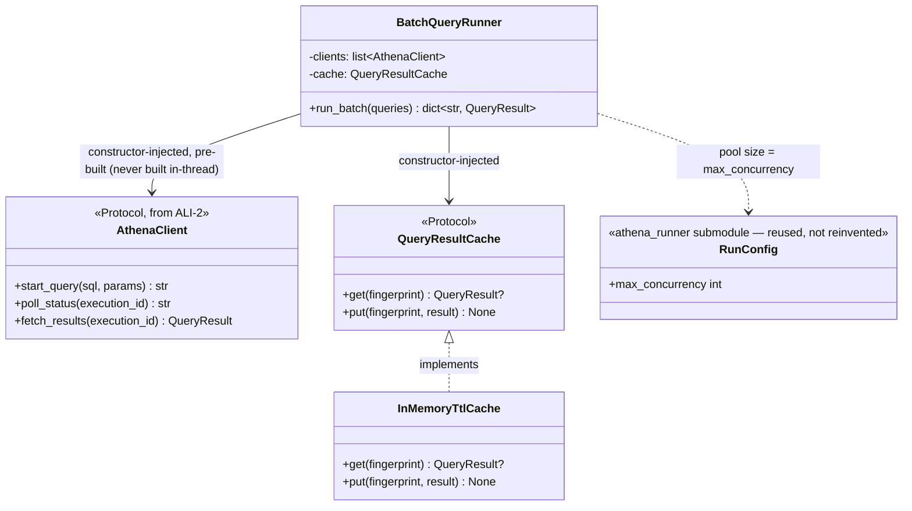
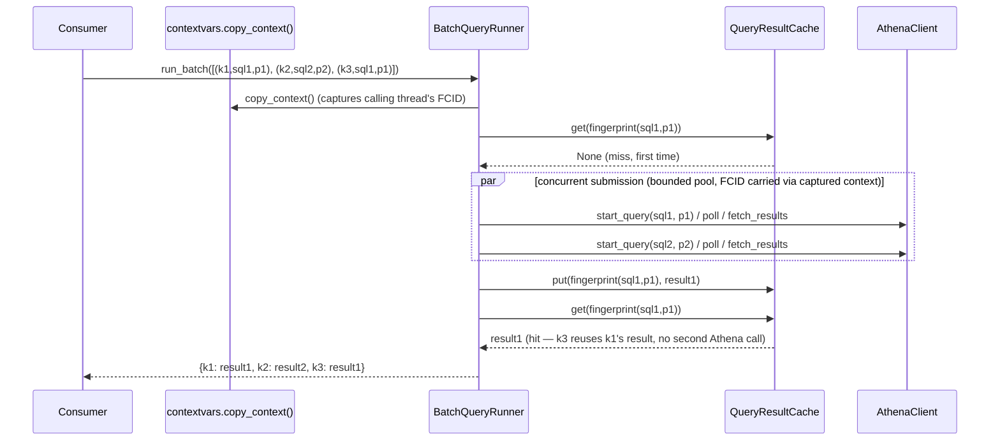
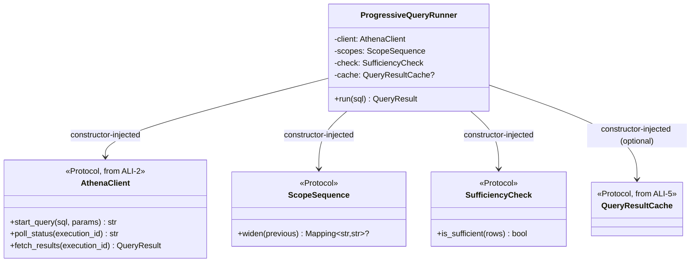
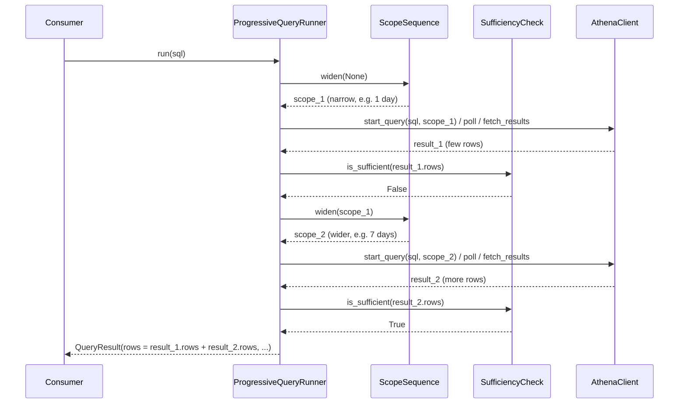

# Athena lib integration — story specs

> One task per session. Find the first unchecked item in `tasks.md`. That is your only task. Full implementation rules live in this project's `AGENTS.md` + `PYTHON_DESIGN.md`. After each task: set
> `SHA:` on the task line + tick the box, update the story status summary, add one line to your backlog/session-log file.

## Architecture — where this story sits

---

## ALI-1 — Add `athena-mcp-server` as a pinned git submodule

**Files to change / create:**
- `.gitmodules` — new `[submodule "athena-mcp-server"]` entry, path e.g. `vendor/athena-mcp-server`, url `https://github.com/abhadrasyna/athena-mcp-server.git`.
- `README.md` (project root) — add a setup step: `git submodule update --init --recursive`.
- `docs/guides/` — short note (append to an existing setup guide, or new `docs/guides/submodules.md` if none exists) on what the submodule provides and how to update its pin.

**What to implement:**

1. `git submodule add https://github.com/abhadrasyna/athena-mcp-server.git vendor/athena-mcp-server`.
2. Pin to the current `HEAD` commit of that repo at add-time (submodules pin by commit automatically — confirm the recorded SHA matches what's expected, no floating branch).
3. Document the init step and the one known open item inherited from that repo's own `CONTEXT.md` (the `aws-access-cli` sibling-checkout namespace-package merge in
   `tool_config.py::_load_mtn_registry`) as a "not this story's problem, but be aware" note — this story's adapter (ALI-2) does not touch `tool_config.py` at all, only the generic `athena_runner`
   package, precisely to avoid depending on that fragile part.

**Tests (no network, no real external services):**
- N/A — this task is repo plumbing, no test gate. Verify instead: a fresh `git clone --recurse-submodules` (or `clone` + `submodule update --init`) of `ih-trace-lab` reproduces the submodule checkout
  with no manual steps beyond the documented command.

**Commit:** `chore(athena): add athena-mcp-server as git submodule`

---

## ALI-2 — `src/lib/athena/adapter.py`: DIP-compliant adapter

**Files to change / create:**
- `src/lib/athena/adapter.py` — new file.
- `src/lib/athena/exceptions.py` — new file (added 2026-10-01, extended design review — see point 4 below).
- `src/lib/athena/__init__.py` — package marker.

**Before writing this file:** re-read `functional-code-taxonomy` FCT-2's `src/lib/athena/protocols.py` — this adapter must implement that exact `Protocol`, not a new one invented here. If FCT-2 is not
yet landed, this task cannot start (see `prompt.md`'s hard gate).

**What to implement:**

1. `PYTHON_DESIGN.md` trigger applied: **DIP** — "a class constructs its own collaborator directly instead of receiving it." `AthenaAdapter.__init__` receives an `athena_runner.query_executor`
   instance (or a narrower `Protocol` over it) and a `result_downloader` collaborator as constructor arguments — it never calls `boto3.client(...)` or constructs `QueryExecutor()` itself.
2. Each method on `AthenaAdapter` is a one-line-to-few-line delegation to the injected `athena_runner` collaborator, translated to/from FCT-2's `Protocol` types where the shapes differ.
3. No SQL text, no per-tenant config, no `tool_config.py`-style registry logic lands here — that stays in the submodule or in a future consumer, per this epic's cross-cutting constraint ("no
   project-specific business rule in `src/lib/*`").
4. **Exception hierarchy (added 2026-10-01, extended design review):** `src/lib/athena/exceptions.py` defines `AthenaAdapterError(Exception)` plus one subclass per
   `athena_runner.exceptions.AthenaRunnerError` subclass the adapter can surface (`AthenaQueryExecutionError`, `AthenaQueryTimeoutError`, `AthenaAuthError`). `AthenaAdapter`'s methods catch
   `athena_runner.exceptions.*` at the delegation boundary and re-raise the mirrored `src/lib/athena` exception (never let the submodule's exception types cross the `Protocol` boundary directly) —
   this keeps the submodule swappable without consumers' `except` clauses needing to change, the same DIP reasoning already applied to the adapter's methods themselves.
5. **Throttling retry/backoff (added 2026-10-01, extended design review):** confirmed by re-reading `athena_runner/query_executor.py` that it has no retry/backoff handling for AWS throttling
   (`ThrottlingException`/`TooManyRequestsException` from `botocore.exceptions.ClientError`) — it only polls on a fixed interval until its own timeout. Wrap `start_query`/`poll_status` calls in
   `AthenaAdapter` with an exponential-backoff retry (e.g. `base_delay=1s, max_retries=5, jitter`) scoped to throttling-class errors only — any other `ClientError` propagates immediately, unretried.
   This is adapter-level resilience, not duplicated business logic, so it does not violate the "thin delegation only" constraint.
6. **Config reuse (added 2026-10-01, extended design review):** `AthenaAdapter` does not invent its own config shape — it accepts (or is constructed from) an `athena_runner.config.RunConfig` (already
   defines `profile`, `workgroup`, `output_location`, `output_dir`, `region`, `poll_interval_seconds`, `timeout_seconds`, `max_concurrency`), consistent with this project's existing precedent of one
   typed config object per module (`src/lib/paths/config.py`'s `PathConfig`, loaded once, passed in — never ad hoc env-var reads scattered through the adapter).
7. **Raw-CSV staging fixed to not leak into `config.output_dir` (follow-up, 2026-10-04):** the original implementation wrote the raw downloaded CSV straight into `config.output_dir` as
   `<query_execution_id>.csv` with no cleanup, reasoning (wrongly) that retention was a future consumer-side concern. In practice this silently accumulated one stray CSV per query run forever, with no
   caller ever actually implementing that retention policy — surfaced once the `aws_access_cli` v2 cron pipeline went live and started dumping dozens of these into `ih-trace-lab/output/` alongside the
   pipeline's real, properly-named reports. Since the `AthenaClient` Protocol never exposes a file path to callers (`QueryResult.rows` is the only thing consumers see), the raw CSV is now purely an
   internal translation detail: `_download_and_translate` stages it under a per-call `tempfile.TemporaryDirectory()` and the file is gone by the time `start_query` returns, success or failure.
   `config.output_dir` is no longer read by the adapter at all — it remains reserved for callers (e.g. `aws_access_cli`'s own pipeline scripts) that want their own named, retained CSVs.

**Class diagram:**

<!-- 2026-10-01 pre-implementation-design-review: this diagram previously named
run_query/poll_status/download_results, which did not match src/lib/athena/protocols.py's actual AthenaClient Protocol (start_query/poll_status/fetch_results) — fixed to match the landed,
authoritative Protocol exactly. See docs/archive/pre-implementation-design-review/spec.md finding #1. -->

**Tests (no network, no real external services):**
- `test_adapter_delegates_start_query` — a fake `QueryExecutor` records the call; adapter returns its result untranslated (or correctly translated).
- `test_adapter_constructor_requires_injection` — instantiating without collaborators raises (no silent default construction of a real `boto3` client).
- `test_adapter_wraps_runner_exception` — a fake `QueryExecutor` raising `athena_runner.exceptions.QueryExecutionError` causes `AthenaAdapter` to raise `AthenaQueryExecutionError`, not the raw
  submodule exception.
- `test_adapter_retries_on_throttling_then_succeeds` — a fake collaborator raising a throttling-shaped error twice then succeeding on the 3rd call still returns the successful result (use a fake
  clock/no real `time.sleep`, matching this epic's no-real-network-delay test convention).
- `test_adapter_does_not_retry_non_throttling_errors` — a fake collaborator raising a non-throttling `ClientError` propagates on the first call, no retry attempted.

**Commit:** `feat(athena): add DIP-compliant adapter over athena_runner`

---

## ALI-3 — Tests: mocked `athena_runner`, `Protocol` conformance pair

**Files to change / create:**
- `tests/lib/athena/test_adapter.py` — new.
- `tests/lib/athena/test_protocol_conformance.py` — new, mirrors FCT-2's own conformance-test pattern.

**What to implement:**

1. Mock/fake `athena_runner.query_executor.QueryExecutor` and `athena_runner.result_downloader` — no real `boto3` calls, no live AWS/network, matching `athena-mcp-server`'s own existing test
   convention (mocked-boto3 unit tests).
2. `test_adapter_satisfies_protocol` — `isinstance(AthenaAdapter(fake_executor, fake_downloader), AthenaClient)` is `True`.
3. `test_non_conforming_stub_fails_protocol` — a stub missing one method is `False` under `isinstance`.
4. **DIP pair (standardized by `pre-implementation-design-review`, finding #2; see `README.md`'s cross-cutting constraints):** `test_adapter_construction_requires_collaborators` — `AthenaAdapter()`
   with no args raises `TypeError`; and `test_adapter_never_calls_boto3_directly` — assert no attribute/module lookup of `boto3` occurs from within `AthenaAdapter`'s own methods (e.g. via
   `unittest.mock.patch("boto3.client")` left un-called, or an explicit source scan), confirming all AWS access is delegated to the injected `athena_runner` collaborators.

**Commit:** `test(athena): mock athena_runner + Protocol conformance`

---

## ALI-4 — Audit: does `athena_runner` already support batch/concurrent submission?

**Added 2026-10-01 (`pre-implementation-design-review` finding #6, scoped via follow-up questions):** expected real-world shape is small batches (2-5 independent queries, e.g. a per-tenant or per-day
fan-out) run together sometimes, plus a need to cache results when the identical SQL+params re-runs. Existing-support status was unknown going in — this task resolves that before any design/code is
written.

**Files to change / create:**
- `stories.md` (this file) — record the finding as a subsection under ALI-5 below, before writing any code.

**What to implement:**

1. Read the `athena-mcp-server` submodule's `athena_runner.query_executor.QueryExecutor` (and any sibling batch/pool helper) for existing concurrent-submission or result-caching support.
2. Record the finding: either cite the existing helper to delegate to (ALI-5 then wraps it, does not reimplement it), or state explicitly that none exists and ALI-5 is net-new design.

**Pre-seeded finding (confirmed during the 2026-10-01 extended design review, so this task's own re-audit should start from here rather than re-discovering it from scratch):**
- `athena_runner.config.RunConfig` already has a `max_concurrency: int = 5` field, whose own docstring says "Not yet consumed by any query executor — reserved for the upcoming parallel task pool."
  Confirms ALI-5 is net-new design (no existing batch/pool implementation to delegate to), but ALI-5's `BatchQueryRunner` should read its worker-pool size from this existing, already-reserved
  `RunConfig.max_concurrency` field rather than inventing an unrelated constructor argument — one config knob, not two.
- `athena_runner.query_executor.py` has no retry/backoff handling for AWS throttling (`ThrottlingException`/`TooManyRequestsException`) — it only polls on a fixed interval until its own timeout.
  Confirmed this is a real gap, not something ALI-5 can assume is already handled underneath it; see ALI-2 point 5 (retry/backoff added at the adapter layer, benefiting single-query and batch use
  equally).
- `athena_runner.aws_clients.AwsClientFactory` builds a new boto3 client from one shared `boto3.Session` per `athena_client()` call. `boto3.Session` object is not documented as safe for concurrent
  client construction from multiple threads (individual constructed clients are thread-safe once created; the Session's own credential-resolution path during client construction is the risk). ALI-5
  must not call `athena_client()` concurrently from inside worker threads — see ALI-5 point 4.

**Re-confirmed 2026-10-02** against the pinned submodule commit (`vendor/athena-mcp-server@9463d00`, same pin ALI-1 locked in): all three pre-seeded findings above still hold —
`RunConfig.max_concurrency: int = 5` is present and unconsumed; `query_executor.py` has no retry/backoff/throttling handling; `AwsClientFactory.__init__` builds one `boto3.Session` per factory
instance and `athena_client()`/`s3_client()`/`sts_client()` all derive from that single shared session. No new batch/pool/cache helper exists anywhere in the submodule. ALI-5 proceeds as net-new
design per the pre-seeded finding; no change to that finding was needed.

**Tests:** N/A — audit/analysis task, no code changes.

**Commit:** `docs(athena): confirm athena_runner batch/cache support status`

---

## ALI-5 — `src/lib/athena/batch.py`: concurrent batch submission + TTL result cache

**Files to change / create:**
- `src/lib/athena/batch.py` — new.
- `src/lib/athena/cache.py` — new.

**What to implement:**

1. `PYTHON_DESIGN.md` triggers applied: **DIP** (both new classes take their collaborators via constructor injection, matching ALI-2's adapter pattern — no direct `athena_runner`/`boto3` access) and
   **Strategy** (the cache is a swappable `Protocol`, not hardcoded to one storage backend).
2. `QueryResultCache` (`Protocol`, `@runtime_checkable`) in `cache.py`: `get(fingerprint: str) -> QueryResult | None`, `put(fingerprint: str, result: QueryResult) -> None`. `fingerprint_query(sql:
   str, params: Mapping[str, str]) -> str` — a free function hashing `(sql, tuple(sorted(params.items())))`, so two calls with the same SQL text and the same params (regardless of dict insertion
   order) collide to the same cache key.
3. `InMemoryTtlCache` in `cache.py` implementing `QueryResultCache`: constructor takes `ttl_seconds: int` (required, no silent default — per this epic's DIP-pair test convention); internally stores
   `{fingerprint: (QueryResult, inserted_at)}`; `get()` returns `None` and evicts the entry if `now - inserted_at > ttl_seconds`.
4. `BatchQueryRunner` in `batch.py`: constructor takes a **sequence of pre-constructed `AthenaClient` instances** (one per intended worker, each backed by its own `athena_client()` call made before
   the pool starts — see point 8) and a `QueryResultCache` — both required collaborators, never constructed internally. `run_batch(queries: Sequence[tuple[str, str, Mapping[str, str]]]) -> dict[str,
   QueryResult]` — each tuple is `(caller_key, sql, params)`; caller keys let the caller correlate results back to its own request list regardless of completion order.
5. Concurrency: use `concurrent.futures.ThreadPoolExecutor` (I/O-bound — waiting on Athena network calls, not CPU-bound work). **Pool size reuses `athena_runner.config.RunConfig.max_concurrency`**
   (confirmed by ALI-4's audit to be an already-reserved-but-unconsumed config field) rather than an independent constructor arg — one concurrency knob project-wide, not two. Document that
   `RunConfig.max_concurrency`'s small default (5) matches the confirmed small-batch shape and that larger fan-outs should revisit it rather than assuming it scales unbounded.
6. Cache-first flow per query: compute `fingerprint_query(sql, params)`; on cache hit, skip `start_query`/polling entirely; on miss, submit via the injected `AthenaClient`, poll to completion, store
   the result in the cache, then return it.
7. No query silently swallows a failure — if one query in the batch raises, record which `caller_key` failed (do not let one failure silently blank out the whole batch's results); exact exception
   propagation strategy (fail-fast vs. partial results) is this task's own design choice to make and document in a code comment, since both are defensible and the project's investigation workflows are
   not CPU-tight enough to mandate one over the other up front. Propagated exceptions must be the `src/lib/athena/exceptions.py` hierarchy from ALI-2, not raw `athena_runner` exceptions.
8. **FCID propagation across threads (added 2026-10-01, extended design review — this was a real gap in the original design, not a hypothetical one):** `flow-correlation-id-logging`'s own `stories.md`
   already warns that `contextvars` do not cross a `ThreadPoolExecutor` boundary automatically — without an explicit fix, every batch worker thread's log lines would silently lose the FCID.
   `run_batch` must capture the calling thread's context via `contextvars.copy_context()` once, then submit each worker callable through that captured context (e.g. `pool.submit(captured_context.run,
   worker_fn, ...)`), so `src/lib/logging`'s FCID filter still finds the right value inside each worker thread. Add a test asserting the FCID present at `run_batch`'s call site is also present on
   every log line emitted from inside a worker (using a fake/injectable log handler, not real log file parsing).
9. **Credential/client reuse under concurrency (added 2026-10-01, extended design review):** per ALI-4's audit finding, `AwsClientFactory`'s `athena_client()` builds a new client from one shared
   `boto3.Session`, which is not documented as safe to call concurrently from multiple threads. `BatchQueryRunner` must never call `athena_client()` (or construct an `AthenaAdapter`) from inside a
   worker thread — all `AthenaClient` instances it uses are constructed up front, sequentially, on the calling thread, before `ThreadPoolExecutor` starts any worker.

**Class diagram:**

**Sequence diagram (batch of 3, one cache hit, FCID propagated into worker threads):**

**Tests:**
- `test_batch_runner_construction_requires_collaborators` — `BatchQueryRunner()` with no args raises `TypeError` (DIP pair, per this epic's standardized convention).
- `test_fingerprint_is_stable_regardless_of_param_order` — `fingerprint_query(sql, {"a": "1", "b": "2"})` equals `fingerprint_query(sql, {"b": "2", "a": "1"})`.
- `test_cache_hit_skips_athena_call` — second identical query in a batch never calls the fake `AthenaClient`'s `start_query`.
- `test_ttl_cache_expires_entry` — `get()` returns `None` after `ttl_seconds` has elapsed (use a fake/injectable clock, not real `time.sleep`).
- `test_run_batch_preserves_caller_keys` — result dict keys match the caller-supplied keys, not submission or completion order.
- `test_one_query_failure_does_not_silently_blank_others` — one fake `AthenaClient` raising for one query still yields correct results for the other `caller_key`s (exact propagation shape per this
  task's documented choice); the raised type is from `src/lib/athena/exceptions.py`.
- `test_fcid_propagates_into_worker_threads` — bind an FCID on the calling thread before `run_batch`; a fake log handler installed on the batch-internal logger shows the same FCID on log lines emitted
  from inside worker threads (fails without the `copy_context()` fix, confirming the gap this task closes).
- `test_pool_size_matches_run_config_max_concurrency` — constructing `BatchQueryRunner` from a `RunConfig(max_concurrency=2)` and a 5-query batch never has more than 2 `AthenaClient` calls in flight
  at once (assert via a fake client that records concurrent-call high-water-mark).

**Commit:** `feat(athena): add concurrent batch submission + TTL result cache`

---

## ALI-6 — `src/lib/athena/progressive.py`: progressive scope-widening query runner

**Added 2026-10-01 (extended design review, requester's own scoping request):** the requester described a recurring investigation shape — fire an Athena query against a small/narrow scope first (e.g.
one day, one tenant), check whether that is enough, and if not, re-run against a progressively larger scope (e.g. 7 days, then 30 days), finally combining every scope's rows into one result — rather
than guessing the right scope up front and either over-fetching (slow, expensive) or under-fetching (missing data, requiring a manual re-run).

**Files to change / create:**
- `src/lib/athena/progressive.py` — new.

**What to implement:**

1. `PYTHON_DESIGN.md` triggers applied: **Template Method** (the widen-check-combine loop shape is fixed; only "what counts as a wider scope" and "what counts as sufficient" vary per consumer) and
   **Iterator** (scopes are produced lazily, one at a time, so a consumer whose first scope already succeeds never pays for computing/running later, wider scopes).
2. `ScopeSequence` (`Protocol`, `@runtime_checkable`): `widen(previous: Mapping[str, str] | None) -> Mapping[str, str] | None` — given the previous scope's params (or `None` for the first call),
   returns the next, wider scope's params, or `None` when there is no wider scope left to try (e.g. already at the max configured lookback). Kept as a `Protocol`, not a fixed enum of "day/week/month"
   steps, so a consumer can define its own widening shape (tenant-count fan-out, time-window fan-out, or any other dimension) without editing this module.
3. `SufficiencyCheck` (`Protocol`, `@runtime_checkable`): `is_sufficient(rows: list[dict[str, str]]) -> bool` — e.g. "at least N rows," "a specific session id is present," decided per consumer, not
   hardcoded here.
4. `ProgressiveQueryRunner` in `progressive.py`: constructor takes an `AthenaClient` (ALI-2's adapter), a `ScopeSequence`, and a `SufficiencyCheck` — all required collaborators (DIP, no silent
   defaults). `run(sql: str) -> QueryResult` — runs `sql` against the first scope's params; if `SufficiencyCheck.is_sufficient(result.rows)` is `False` and `ScopeSequence.widen(...)` returns a
   non-`None` next scope, re-runs `sql` against that wider scope; repeats until sufficient or `widen()` returns `None`. The returned `QueryResult` combines rows from **every** scope actually run (not
   just the last one) — a result found at the narrow scope is never silently dropped once a wider scope also runs; de-duplicate combined rows only if the caller-supplied `SufficiencyCheck` exposes a
   duplicate key (optional; document as a known limitation if not provided — do not invent silent dedup logic here).
5. Every widened re-run goes through the same cache-first path as ALI-5's `BatchQueryRunner` where practical — if a consumer already has a `QueryResultCache` constructed, `ProgressiveQueryRunner`
   should accept it as an optional collaborator and consult it before each scope's re-run, so retrying a scope a user has already paid for (e.g. the same narrow scope from a previous investigation
   run) doesn't resubmit to Athena.
6. No query silently swallows a failure — a scope-run's `AthenaClient` exception is `src/lib/athena/exceptions.py`'s hierarchy (ALI-2), propagated immediately; `ProgressiveQueryRunner` does not
   catch-and-continue past a real query failure (that is different from "not enough rows yet," which is expected and drives widening, not an error).

**Class diagram:**

**Sequence diagram (narrow scope insufficient, widens once, then combines):**

**Tests:**
- `test_runner_construction_requires_collaborators` — `ProgressiveQueryRunner()` with no args raises `TypeError` (DIP pair).
- `test_runner_stops_at_first_sufficient_scope` — a fake `SufficiencyCheck` returning `True` on the first scope means `ScopeSequence.widen` is called exactly once (for the first scope) and never
  again.
- `test_runner_combines_rows_across_all_scopes_run` — combined `QueryResult.rows` include rows from every scope actually executed, not only the last one.
- `test_runner_stops_when_widen_returns_none` — a `ScopeSequence` that exhausts after 2 scopes stops cleanly (no 3rd query attempt) even if `SufficiencyCheck` still returns `False`.
- `test_runner_propagates_real_query_failure_immediately` — a fake `AthenaClient` raising on the 2nd (widened) scope propagates that exception, does not silently fall back to the 1st scope's partial
  result.
- `test_runner_consults_cache_before_rerunning_a_scope` — given an optional `QueryResultCache` pre-populated for a scope, that scope's `AthenaClient.start_query` is never called.

**Commit:** `feat(athena): add progressive scope-widening query runner`

---

## ALI-7 — Doc/`CONTEXT.md` pointers

**Files to change / create:**
- `CONTEXT.md` — one new "What Exists" line for this story.
- Project root `README.md` (or `docs/guides/`) — submodule init step, if not already covered by ALI-1.
- `docs/archive/src-lib-migration/README.md` — update this story's row in the "Stories" status table to ✅ Done with closing SHA (final task of the story).

**What to implement:**

1. `CONTEXT.md` line: `src/lib/athena/adapter.py` — thin DIP adapter over the `athena-mcp-server` git submodule's `athena_runner` package; no Athena execution logic duplicated in `ih-trace-lab`.
2. `CONTEXT.md` line: `src/lib/athena/batch.py` + `cache.py` — bounded-concurrency batch submission with a shape-keyed-by-fingerprint TTL result cache, for consumers submitting multiple independent
   queries (e.g. per-tenant/per-day fan-out).
3. `CONTEXT.md` line: `src/lib/athena/progressive.py` — progressive scope-widening query runner (narrow scope first, widen only if insufficient, combine rows across every scope actually run).
4. Confirm no drift: re-read `docs/archive/src-lib-migration/README.md`'s Supersession/coordination note and confirm it still accurately describes the landed state.

**Tests:** N/A — docs only.

**Commit:** `docs(athena): point CONTEXT.md at the new adapter + batch/cache + progressive layers`
