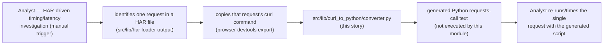
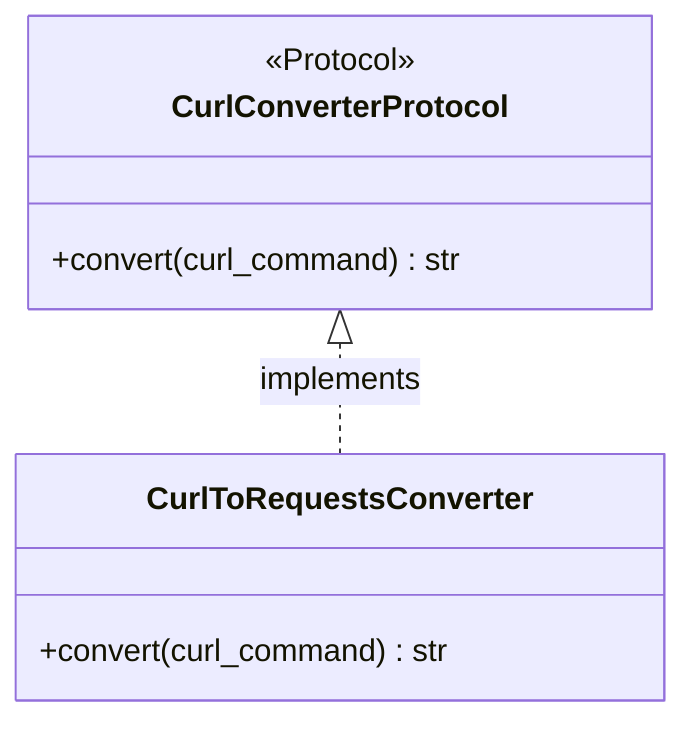
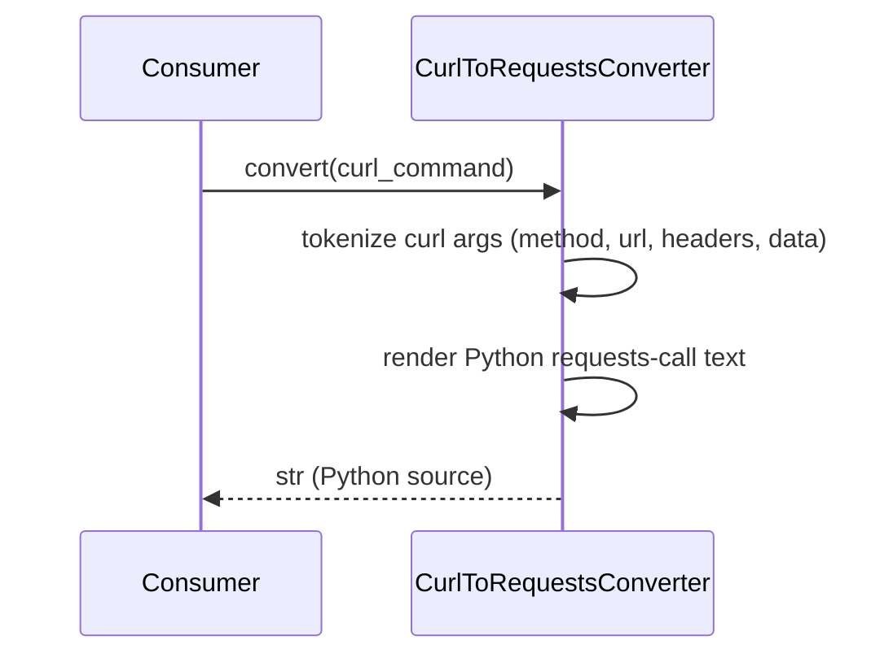

# Curl to python lib migration — story specs

> One task per session. Find the first unchecked item in `tasks.md`. That is your only task. After each task: set `SHA:` on the task line + tick the box, update the story status summary, add one line
> to your backlog/session-log file.

## Architecture — where this story sits

---

## CPM-1 — Confirm/derive replaced-originals citation + consumer scenario

**Files to change / create:**
- `stories.md` (this file) — record the finding as a subsection under CPM-2 below.

**What to implement:**

1. Re-read `functional-code-taxonomy`'s FCT-1 audit text for any `curl_to_python`-relevant file citation (search for "curl" across its `prompt.md`/`stories.md`).
2. Record the confirmed consumer scenario (2026-10-01, `pre-implementation-design-review` follow-up): invocation is manual/ad hoc, not pipeline-automated — during a HAR-driven timing/latency
   investigation, an analyst identifies one request in a HAR file (via `src/lib/har`'s loader), copies that request's curl command as exported by browser devtools, and invokes this converter to get a
   repeatable Python script for re-running/timing that single request. This is the module's real trigger, not a speculative build-ahead-of-a-proven-need.
3. If a citation is found on re-read, record it here instead and adjust CPM-3's implementer to match its actual shape rather than inventing one.

**Tests:** N/A — audit/analysis task.

**Commit:** `docs(curl_to_python): confirm replaced-originals citation`

### CPM-1 finding (2026-10-02)

FCT-1's audit cites `src/lib/curl_to_python/` as replacing "the curl-command-to-Python-code converter itself (from `mtn-network-traffic`)" but names no specific file. Re-reading FCT-1's text found no
other `curl`-relevant citation beyond that one line and the already-separately-cited `mtn-network-traffic/scripts/curl_timer/report.py` (cited under `csv_io`, not here).

Re-deriving the actual shape from `mtn-network-traffic/scripts/curl_timer/` directly (read-only — no `github_copilot` changes made) found **no file that converts a curl command into Python `requests`
source text**. The package's modules (`curl_timing.py`, `blocks.py`, `jwt_inspect.py`, `markdown_report.py`, etc.) extract and **shell out to the real `curl` binary** to measure request-phase timing
(DNS/TLS/TTFB) directly — they never generate a `requests`-call equivalent. FCT-1's citation describes this story's intended module by its target responsibility, not an existing file it is literally
replacing; no existing converter-shaped original exists to match CPM-3's implementer against.

**Consequence:** CPM-3 is built directly from this story's own locked-in grammar spec (`prompt.md`'s "Locked-in decisions") rather than ported/adapted from any `mtn-network-traffic` file. The
confirmed consumer scenario (HAR-driven timing/latency investigation; analyst copies one request's curl command, converts it, re-runs/times it standalone) stands as recorded above and is unaffected by
this finding — it describes a real, distinct manual workflow, independent of whether a prior converter implementation exists to port from.

---

## CPM-2 — `src/lib/curl_to_python/protocols.py`: new `CurlConverterProtocol`

**Files to change / create:**
- `src/lib/curl_to_python/protocols.py` — new.
- `src/lib/curl_to_python/__init__.py` — package marker.

**What to implement:**

1. `PYTHON_DESIGN.md` trigger applied: **SRP** — parsing belongs to one function/class, not scattered inline per investigation script.
2. Define `CurlConverterProtocol` (`convert(curl_command: str) -> str`, returning generated Python source text) as a `Protocol`, `@runtime_checkable`, method signature only.

**Class diagram:**

**Tests (no network, no real external services):**
- `test_conforming_stub_satisfies_protocol`.
- `test_non_conforming_stub_fails_protocol`.

**Commit:** `feat(curl_to_python): define CurlConverterProtocol`

---

## CPM-3 — `src/lib/curl_to_python/converter.py`: concrete implementer

**Files to change / create:**
- `src/lib/curl_to_python/converter.py` — new.

**What to implement:**

1. `CurlToRequestsConverter.convert(curl_command)` parses a curl command string (method, URL, headers, data) and returns Python source text using the `requests` library shape — text generation only,
   no `exec`/`eval`, no network call.
2. `PYTHON_DESIGN.md` trigger applied: **Factory Method** — if multiple output shapes are ever needed (e.g. `requests` vs. `httpx`), a factory selects the converter; this task builds only the one
   proven shape (`requests`), per YAGNI.

**Sequence diagram:**

**Tests (no network, no real external services):**
- `test_convert_get_request` — simple `curl -X GET <url>` → expected Python text.
- `test_convert_post_with_headers_and_data` — assert headers/data dict rendered correctly.
- `test_convert_does_not_execute_request` — assert no network call is made during conversion.

**Commit:** `feat(curl_to_python): add CurlToRequestsConverter`

---

## CPM-4 — Tests + `Protocol` conformance pair

**Files to change / create:**
- `tests/lib/curl_to_python/test_converter.py` — new.
- `tests/lib/curl_to_python/test_protocol_conformance.py` — new.

**What to implement:**

1. Cover CPM-3's test list plus edge cases (multi-line curl with `\` continuations, quoted arguments).
2. `Protocol` conformance pair against the concrete `CurlToRequestsConverter`.

**Commit:** `test(curl_to_python): converter tests + Protocol conformance`

---

## CPM-5 — Doc/`CONTEXT.md` pointers

**Files to change / create:**
- `CONTEXT.md` — one new "What Exists" line.
- `docs/archive/src-lib-migration/README.md` — update this story's row to ✅ Done with closing SHA.

**What to implement:**

1. `CONTEXT.md` line: `src/lib/curl_to_python/converter.py` — curl→Python `requests`-call converter, `Protocol`-based, built ahead of a proven-duplication trigger per this epic's explicit
   authorization (cite CPM-1's finding).

**Tests:** N/A — docs only.

**Commit:** `docs(curl_to_python): point CONTEXT.md at the new converter module`
