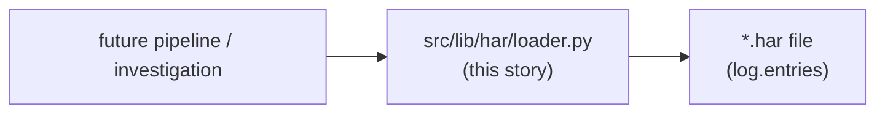
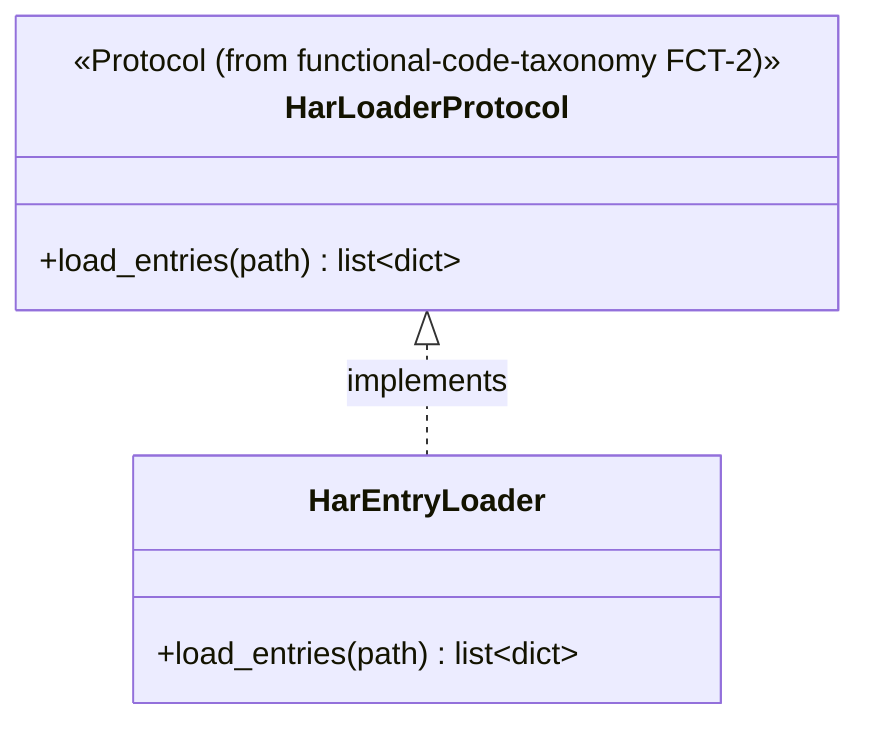
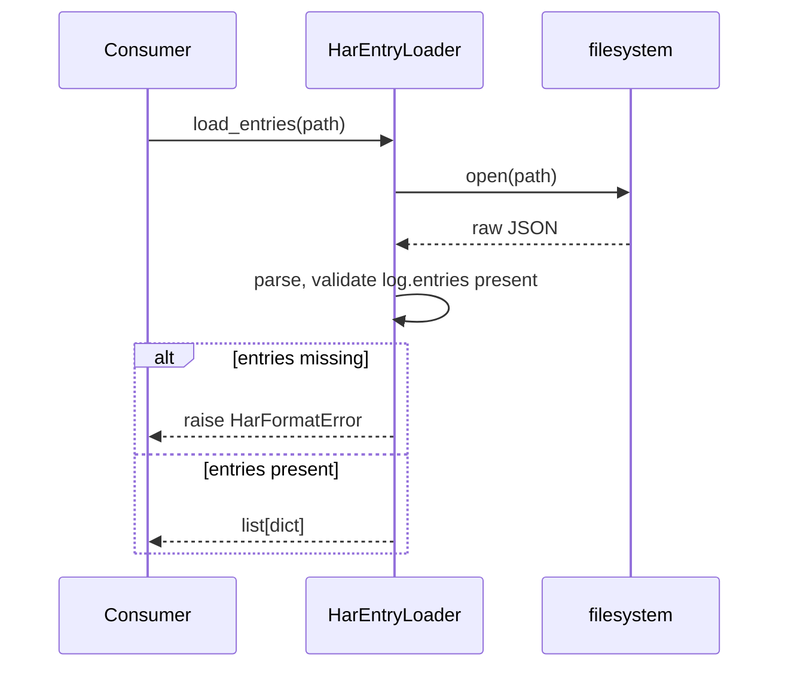

# Har lib migration — story specs

> One task per session. Find the first unchecked item in `tasks.md`. That is your only task. After each task: set `SHA:` on the task line + tick the box, update the story status summary, add one line
> to your backlog/session-log file.

## Architecture — where this story sits

---

## HLM-1 — Re-confirm audit list

**Status: DONE (requester-approved 2026-10-02) — resolves this task's conditional STOP gate.** HLM-2 may proceed directly against the finding below without re-auditing.

### Audit findings

Read-only comparison of all four originals' actual function bodies found real divergence, not just copy-paste cosmetics:

| Original | Return shape | Behavior |
|---|---|---|
| `applauseInvestigation/scripts/analyze_har.py::iter_entries()` | generator, raw HAR entry dicts | streams via `ijson` if available, else `json.load` + yield; no filtering |
| `vod-playback-timing-probe/scripts/extract_content_ids_from_har.py::_load_entries()` | list, raw HAR entry dicts | plain `json.load()["log"]["entries"]`; no filtering |
| `vod-playback-timing-probe/scripts/summarize_har_playbacks.py::_load_entries()` | list, raw HAR dicts | identical to row above — confirms "twice in same project" |
| `vod-asset-ingestion-mapping/scripts/lib/har_parser.py::load_json_entries()` | list of `HarJsonEntry` (different type) | filters by JSON mimetype/URL, decodes + parses response body |

**Resolution:** `load_json_entries()` bundles two concerns — loading `log.entries` (identical mechanism to the other three) and JSON-mimetype/URL filtering + response-body parsing (unique to that
project, and not representable by the already-landed `HarEntry` dataclass, which has no response-content field). Per this project's own shared-vs-specific test
(`docs/guides/functional-code-taxonomy.md`), the filter/parse behavior is project-specific business logic, not a reusable mechanism. `src/lib/har/loader.py` (HLM-2) therefore covers:
- the shared `log.entries`-loading mechanism for all four originals (dropping `analyze_har.py`'s `ijson`-streaming path — no cited consumer needs multi-GB streaming, and FCT-2's `Protocol` already
  fixed a `list[HarEntry]` return, not a generator — this is YAGNI, not a new decision);
- explicitly **not** `load_json_entries()`'s JSON-filter/parse step, which stays out of scope for the shared loader (consistent with this story's own "Out of scope: any HAR-entry
  *filtering*/business-rule logic specific to one investigation").

No code under `/Users/abhadra/github_copilot` or `src/lib/har/protocols.py` is touched by this finding — both remain read-only/out-of-scope per this story's existing constraints.

**Files changed:** none — this section is the task's deliverable, recorded here by prior agreement rather than produced by a dedicated commit.

**Tests:** N/A — audit/analysis task.

**Commit:** `docs(har): confirm loader audit`

---

## HLM-2 — `src/lib/har/loader.py`: concrete loader

**Files to change / create:**
- `src/lib/har/loader.py` — new.
- `src/lib/har/__init__.py` — package marker.

**Before writing this file:** re-read `functional-code-taxonomy` FCT-2's `src/lib/har/protocols.py` (seeded from `vod-asset-ingestion-mapping`'s `load_json_entries()`) — implement that `Protocol`
exactly.

**What to implement:**

1. `PYTHON_DESIGN.md` trigger applied: **SRP** — "a pure domain-mechanism function has no business being copy-pasted per project." One function/class here replaces all four originals.
2. Accept a file path (or open file handle) as an argument — no hardcoded/project-specific path.
3. Raise a clear, specific exception (not a bare `except`) on malformed HAR JSON (missing `log.entries`) — matches this project's "fail loudly, no silently-wrong partial results" convention.

**Class diagram:**

**Sequence diagram:**

**Tests (no network, no real external services):**
- `test_load_entries_returns_list` — fixture HAR file, assert entry count/shape.
- `test_load_entries_raises_on_malformed_har` — fixture missing `log.entries`, assert specific exception type.

**Commit:** `feat(har): add HAR entry loader`

---

## HLM-3 — Tests + `Protocol` conformance pair

**Files to change / create:**
- `tests/lib/har/test_loader.py` — new.
- `tests/lib/har/test_protocol_conformance.py` — new.
- `tests/lib/har/fixtures/` — sample `.har` fixture files (valid + malformed).

**What to implement:**

1. `test_conforming_loader_satisfies_protocol` — `isinstance(HarEntryLoader(), HarLoaderProtocol)` is `True`.
2. `test_non_conforming_stub_fails_protocol` — a stub missing `load_entries` is `False`.

**Commit:** `test(har): loader tests + Protocol conformance`

---

## HLM-4 — Doc/`CONTEXT.md` pointers

**Files to change / create:**
- `CONTEXT.md` — one new "What Exists" line.
- `docs/archive/src-lib-migration/README.md` — update this story's row to ✅ Done with closing SHA.

**What to implement:**

1. `CONTEXT.md` line: `src/lib/har/loader.py` — HAR entry loader replacing the 4 duplicated `github_copilot` originals (cite HLM-1's confirmed list).

**Tests:** N/A — docs only.

**Commit:** `docs(har): point CONTEXT.md at the new loader`
