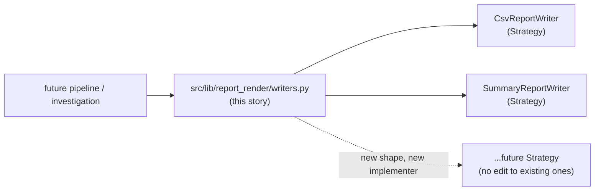
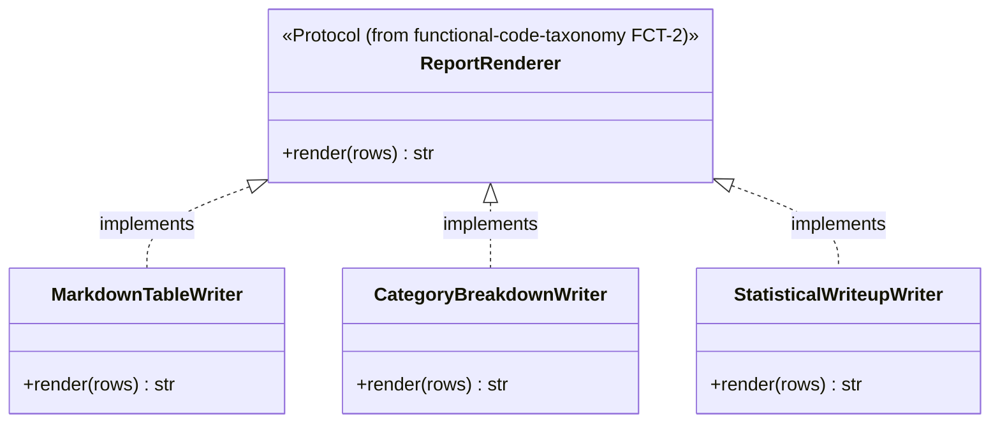
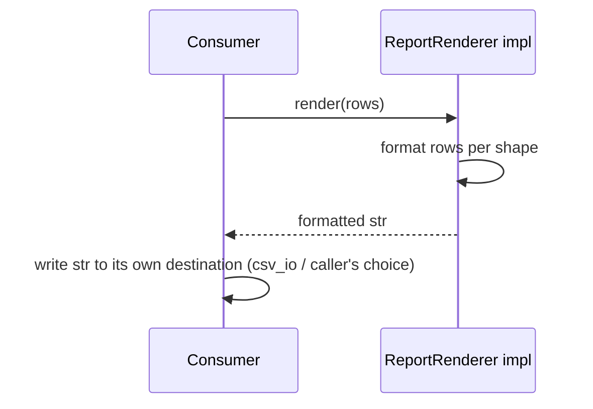
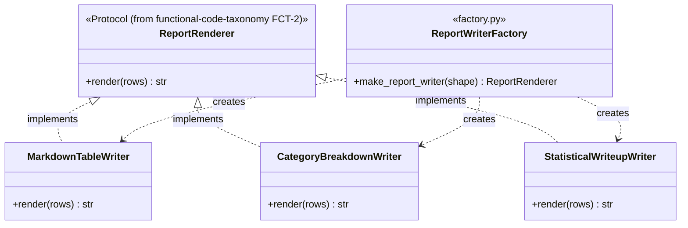

# Report render lib migration — story specs

> One task per session. Find the first unchecked item in `tasks.md`. That is your only task. After each task: set `SHA:` on the task line + tick the box, update the story status summary, add one line
> to your backlog/session-log file.

## Architecture — where this story sits

---

## RRM-1 — Re-confirm audit list, group by shape

**Status: DONE (requester-approved 2026-10-02) — satisfies this task's STOP gate, pre-implementation sign-off.** RRM-2 may proceed directly against the grouping below without re-auditing.

### Audit findings

Read-only audit across the five `functional-code-taxonomy` FCT-1-cited projects found 18 relevant files, not the original "8+" estimate; 13 are `csv_io`'s (see
`docs/archive/src-lib-migration/csv-io-lib-migration/stories.md` CIM-1). The remaining 5 are `report_render`'s, grouped into **3 Strategy shapes**:

**Shape 1 — `MarkdownTableWriter`** (flat markdown table, one row per event/item):
- `github_copilot/vod-playback-timing-probe/scripts/generate_timing_report.py`
- `github_copilot/vod-playback-timing-probe/scripts/playback_probe/har_probe_comparison_report.py`

**Shape 2 — `CategoryBreakdownWriter`** (counts by category + most-common top-N; markdown-file and console-print are a *destination* difference, handled by the writer's path/file-handle contract, not
a separate shape):
- `github_copilot/mtn-zm-session-device-investigation/scripts/generate_summary.py`
- `github_copilot/mtn-zm-session-device-investigation/scripts/summarize_final_session_report.py`

**Shape 3 — `StatisticalWriteupWriter`** (richer multi-section write-up: distribution + buffering/startup stats + outliers + breakdowns + anomaly scan — structurally distinct from Shape 2, not merged
with it):
- `github_copilot/ctap-smvod-session-report/scripts/analyze_outcome_report.py`

`src/lib/report_render/writers.py` (RRM-2) implements exactly these 3 Strategy classes — no more, no fewer — covering all 5 cited originals.

**Files changed:** none — this section of `stories.md` is itself the task's deliverable, recorded here by prior agreement rather than produced by a dedicated commit.

**Tests:** N/A — audit/analysis task, no code changes.

**Commit:** `docs(report_render): confirm writer audit, group by shape`

---

## RRM-2 — `src/lib/report_render/writers.py`: Strategy implementer(s)

**2026-10-02 correction (resolves a conflict found when RRM-2 was picked up):** `prompt.md`'s "Writer destination contract" locked-in decision and this section's diagrams originally described
`write(destination, rows) -> None` (file-path/handle writers). That predates `functional-code-taxonomy` FCT-2's finalized `src/lib/report_render/protocols.py`, which actually landed as
`ReportRenderer.render(rows: list[dict[str, str]]) -> str` — pure in-memory rendering, no destination parameter at all; FCT-2's own design deliberately splits rendering (this story) from file I/O
(`csv_io`, a separate story). This story's own hard gate ("implement that `Protocol` exactly, do not invent a new one") and scope guard ("the `Protocol` definition itself ... not re-litigated here")
both require following the real, already-shipped shape — so the destination-contract decision is superseded and the diagrams below are corrected to match reality, with the 3 real shapes from RRM-1
(not the earlier placeholder `CsvReportWriter`/`SummaryReportWriter` names).

**Files to change / create:**
- `src/lib/report_render/writers.py` — new.
- `src/lib/report_render/__init__.py` — already exists (added by FCT-2).

**Before writing this file:** re-read `functional-code-taxonomy` FCT-2's `src/lib/report_render/protocols.py` — implement that `Protocol` exactly, do not invent a new one.

**What to implement:**

1. `PYTHON_DESIGN.md` trigger applied: **OCP** — "adding a new report format is a new copy-pasted `to_csv`/print-loop." Instead: one Strategy implementer class per shape from RRM-1's list
   (`MarkdownTableWriter`, `CategoryBreakdownWriter`, `StatisticalWriteupWriter`), each satisfying FCT-2's `ReportRenderer` `Protocol`; a new shape in future is a new implementer class, never an
   edited existing one.
2. Each implementer's `render(rows)` returns a fully-formatted string with no file I/O of its own (matches FCT-2's split: this module renders, `csv_io`/the caller writes); no implementer touches a
   hardcoded/global file path (keeps it project-agnostic, matches the "no project-specific business rule in `src/lib/*`" cross-cutting constraint).

**Class diagram:**

**Sequence diagram (typical render flow):**

**Tests (no network, no real external services):**
- `test_markdown_table_writer_renders_expected_rows` — assert exact string content for a small row set.
- `test_category_breakdown_writer_includes_counts_and_top_n` — assert category counts + top-N section present.
- `test_statistical_writeup_writer_includes_all_sections` — assert distribution/buffering/outliers/breakdown/anomaly sections all present.

**Commit:** `feat(report_render): add Strategy-based report renderers`

---

## RRM-3 — `src/lib/report_render/factory.py`: writer selection Factory

**Files to change / create:**
- `src/lib/report_render/factory.py` — new.
- `src/lib/report_render/protocols.py` — re-read (do not edit) FCT-2's `ReportRenderer` Protocol; this task adds a sibling, not a replacement.

**Why this task exists (2026-10-01, `pre-implementation-design-review` finding #4):** RRM-2 defines one Strategy implementer per report shape but leaves selection between them to each consumer — every
call site would need its own `if shape == "markdown_table": MarkdownTableWriter() else: ...` branch, which is exactly the OCP violation RRM-2 was meant to close, just moved to the call sites instead
of removed. This task closes that gap with a Factory Method so consumers depend only on a shape key, never on a concrete writer class name.

**What to implement:**

1. `PYTHON_DESIGN.md` trigger applied: **Factory Method** — one function owns "which `ReportRenderer` implementer corresponds to this shape key," so adding a new shape is a one-line registry entry,
   never an edited `if`/`elif` chain at every call site.
2. `REPORT_SHAPE_REGISTRY: dict[str, type[ReportRenderer]]` module-level mapping from a shape key (the same shape names RRM-1 recorded: `"markdown_table"`, `"category_breakdown"`,
   `"statistical_writeup"`) to its writer class.
3. `make_report_writer(shape: str) -> ReportRenderer` — looks up `REPORT_SHAPE_REGISTRY[shape]`, instantiates it, and raises a clear `ValueError` (listing valid keys) for an unknown shape — never a
   silent `None`/default fallback.
4. No consumer imports `MarkdownTableWriter`/`CategoryBreakdownWriter`/`StatisticalWriteupWriter` directly going forward — `RRM-4`'s doc pointer should say so explicitly so future consumers use the
   factory, not the concrete classes.

**Class diagram:**

**Tests:**
- `test_make_report_writer_returns_markdown_table_writer` — `make_report_writer("markdown_table")` is an instance of `MarkdownTableWriter`.
- `test_make_report_writer_returns_category_breakdown_writer` — `make_report_writer("category_breakdown")` is an instance of `CategoryBreakdownWriter`.
- `test_make_report_writer_returns_statistical_writeup_writer` — `make_report_writer("statistical_writeup")` is an instance of `StatisticalWriteupWriter`.
- `test_make_report_writer_unknown_shape_raises` — `make_report_writer("nonsense")` raises `ValueError` listing valid keys.

**Commit:** `feat(report_render): add Factory Method for writer selection`

---

## RRM-4 — Tests + `Protocol` conformance pair

**Files to change / create:**
- `tests/lib/report_render/test_writers.py` — new.
- `tests/lib/report_render/test_protocol_conformance.py` — new.

**What to implement:**

1. `test_conforming_writer_satisfies_protocol` — `isinstance(MarkdownTableWriter(), ReportRenderer)` is `True`.
2. `test_non_conforming_stub_fails_protocol` — a stub missing `render` is `False`.
3. All writer tests work on in-memory row lists only — no filesystem/temp-dir I/O (this module renders strings; it does not write files, per RRM-2's corrected scope).

**Commit:** `test(report_render): writer tests + Protocol conformance`

---

## RRM-5 — Doc/`CONTEXT.md` pointers

**Files to change / create:**
- `CONTEXT.md` — one new "What Exists" line.
- `docs/archive/src-lib-migration/README.md` — update this story's row to ✅ Done with closing SHA.

**What to implement:**

1. `CONTEXT.md` line: `src/lib/report_render/writers.py` + `factory.py` — Strategy-based report writers, selected via a Factory Method keyed by shape, replacing the 8+ duplicated `github_copilot`
   originals (cite RRM-1's grouped list).
2. Note explicitly that future consumers call `make_report_writer(shape)`, never import a concrete writer class directly.

**Tests:** N/A — docs only.

**Commit:** `docs(report_render): point CONTEXT.md at the new writers + factory`
