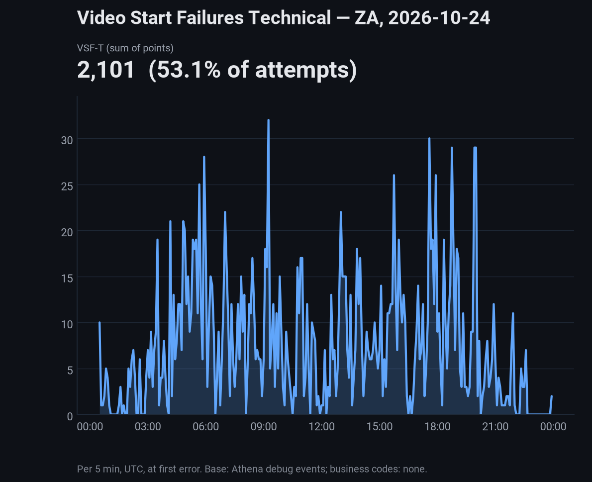

# VSF-T summary with error detail, option A — ZA, 2026-10-24

VSF-T counts sessions that failed to start because of a technical player error ([Conviva](https://docs.conviva.ai/sei/video/metric-dictionary/video-start-failures-technical/)). Here: a session with a
player error before playing, counted at the first error, UTC, 5-minute buckets. Business codes: none configured, so all VSF is technical.

## Headline

- VSF-T: **2,101** of 3,954 attempts (**53.1%**); VSF-B: 0
- Peak 5-minute bucket: 32 at 09:15 UTC

## Error codes

A session can carry several codes, so rows do not add up to VSF-T. Households are distinct `householdId` values (865 across all attempts; 22 VSF-T sessions have none). Times are the first and last
failure in UTC.

| Code | VSF-T sessions | % of VSF-T | % of attempts | Impacted HHs | % of all HHs | Sessions per HH | First seen | Last seen |
|---|---|---|---|---|---|---|---|---|
| 6001 | 1,898 | 90.3% | 48.00% | 358 | 41.39% | 5.3 | 00:30 | 23:55 |
| 3016 | 105 | 5.0% | 2.66% | 25 | 2.89% | 4.2 | 04:51 | 21:41 |
| 1003 | 29 | 1.4% | 0.73% | 21 | 2.43% | 1.4 | 05:35 | 22:33 |
| 6002 | 20 | 1.0% | 0.51% | 7 | 0.81% | 2.9 | 04:42 | 18:08 |
| 6006 | 9 | 0.4% | 0.23% | 2 | 0.23% | 4.5 | 17:43 | 19:48 |
| 3015 | 7 | 0.3% | 0.18% | 2 | 0.23% | 3.5 | 18:21 | 18:50 |
| E31012 | 7 | 0.3% | 0.18% | 6 | 0.69% | 1.2 | 09:20 | 21:37 |
| 1002 | 7 | 0.3% | 0.18% | 6 | 0.69% | 1.2 | 03:13 | 18:02 |
| 6007 | 6 | 0.3% | 0.15% | 2 | 0.23% | 3.0 | 08:50 | 13:59 |
| 1001 | 5 | 0.2% | 0.13% | 4 | 0.46% | 1.2 | 04:44 | 21:53 |

## Top 10 content by VSF-T

| # | Content | VSF-T | % of VSF-T | Households |
|---|---|---|---|---|
| 1 | Zuluboy's 10% | 120 | 5.7% | 62 |
| 2 | KOKO: The Box TV | 115 | 5.5% | 65 |
| 3 | Communication Blok | 111 | 5.3% | 58 |
| 4 | Cabin 28 | 100 | 4.8% | 60 |
| 5 | Crossroads of Fate | 98 | 4.7% | 57 |
| 6 | My Sister Stole My Man | 67 | 3.2% | 35 |
| 7 | Betrayed | 66 | 3.1% | 40 |
| 8 | Kasi (Seshego) Hustle | 57 | 2.7% | 11 |
| 9 | The Day We Got Married | 52 | 2.5% | 21 |
| 10 | Led Steppin | 51 | 2.4% | 34 |
|  | Not resolved (no title) | 22 | 1.0% |  |

## Playback type

| Type | VSF-T | % of VSF-T |
|---|---|---|
| VOD | 2,101 | 100.0% |

## Error code detail

Detail tables use the 2,085 VSF-T sessions with a flat error row, grouped by each session's first error. `is_wv` is shown for 6001 only. Est. bandwidth is Shaka's `estimatedbandwidth`; the player
reports it only once it has started downloading, so "no data" rows are failures before that point.

Preview for choosing the layout. VSF-T sessions only (2,101; 2,085 have a flat error row), grouped by each session's first error, from the flattened raw `PLAYER_ERROR` eventdata. `is_wv` is shown for
6001 only.

### 6001 (1,887 sessions)

| Phase | % | | Network | % | | WebView | % | | Est. bandwidth | % |
|---|---|---|---|---|---|---|---|---|---|---|
| LOADING | 100.0% | | 4g | 99.6% | | true | 94.3% | | no data | 100.0% |
| | | | 3g | 0.4% | | false | 5.7% | | | |

Shaka error: `DRM.REQUESTED_KEY_SYSTEM_CONFIG_UNAVAILABLE` for 100.0% of sessions.

### 3016 (104 sessions)

| Phase | % | | Network | % | | Pipeline status | % | | Est. bandwidth | % |
|---|---|---|---|---|---|---|---|---|---|---|
| SEEKING | 96.2% | | 4g | 64.4% | | `PIPELINE_ERROR_DECODE` (merged) | 99.0% | | under 1 Mbps | 13.5% |
| BUFFERING | 1.9% | | 3g | 33.7% | | `Media failed to decode` | 1.0% | | 1 to 3 Mbps | 36.5% |
| STALLED | 1.0% | | (blank) | 1.0% | | | | | 3 to 10 Mbps | 33.7% |
| LOADED_METADATA | 1.0% | | slow-2g | 1.0% | | | | | over 10 Mbps | 15.4% |
| | | | | | | | | | no data | 1.0% |

Estimated bandwidth p50 2.9 / p90 14.0 Mbps (n=103).

The merged `PIPELINE_ERROR_DECODE` group is 76 + 17 + 10 sessions (three spellings, one with "video decoder reinitialization failed").

### 1003 (29 sessions)

| Phase | % | | Network | % | | Host | % | | Est. bandwidth | % |
|---|---|---|---|---|---|---|---|---|---|---|
| LOADING | 62.1% | | 4g | 72.4% | | SSAI (`vod-dai-ott-eu2.ssai.iris.synamedia.com`) | 58.6% | | under 1 Mbps | 13.8% |
| WAITING | 17.2% | | 3g | 27.6% | | MTN CDN (`sa-vod.cdn.yellotv.mtn.com`) | 41.4% | | 1 to 3 Mbps | 3.4% |
| LOADED_METADATA | 6.9% | | | | | | | | 3 to 10 Mbps | 6.9% |
| BUFFERING | 6.9% | | | | | | | | over 10 Mbps | 13.8% |
| SEEKING | 6.9% | | | | | | | | no data | 62.1% |

Estimated bandwidth p50 6.4 / p90 25.6 Mbps (n=11 only).

### E31012 (7 sessions)

| Phase | % | | Network | % | | Est. bandwidth | % |
|---|---|---|---|---|---|---|---|
| SEEKING | 57.1% | | 3g | 57.1% | | under 1 Mbps | 28.6% |
| LOADING | 28.6% | | 4g | 42.9% | | 1 to 3 Mbps | 14.3% |
| BUFFERING | 14.3% | | | | | 3 to 10 Mbps | 14.3% |
| | | | | | | over 10 Mbps | 14.3% |
| | | | | | | no data | 28.6% |

Estimated bandwidth p50 1.3 / p90 16.8 Mbps (n=5 only).
