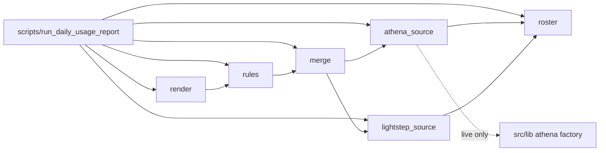

# Household usage tracking — design review (UT-1)

Output of the UT-1 audit. Docs only; no code written. Decisions marked **Proposed** need the user's confirmation before UT-2 starts.

## 1. Prior-art audit

| Candidate | Finding | Verdict |
|---|---|---|
| `scripts/lib/household_trace.py` | Single-household Lightstep UQL plus Athena join. Not roster driven. | Reject as a base; `pick_debug_suffix` models the debug-table lookup. |
| `investigations/ctap-smvod/scripts/run_athena_*.py` | Produce the tenant-wide local CSVs. Not importable as a library from a pipeline. | Reject as a dependency; consume their CSV outputs. |
| `src/pipelines/aws_access_cli/runtime.py` | `RuntimeConfig`, `make_auth()`, `make_athena_client()`. Used by the `run_*_reports` scripts via `scripts/common`. | Reuse the logic, but see decision 3. |
| `src/lib/athena/` (`AthenaAdapter`) | Query execution adapter. | Reuse behind the `SessionSource` seam. |
| `src/lib/report_render/protocols.py` | `ReportRenderer.render(rows: list[dict[str, str]]) -> str`. | Reuse for the table sections; wrap in `render.py`. |
| `src/lib/logging/` | `init_logging`, `bind_fcid`, `redact_params`. | Reuse as is. |
| `docs/plan/shared-pipeline-runtime/` | SPR-1..6 all open. | Cannot reuse run-summary or SSO pre-flight yet; do not block on it. |
| Roster loader | None found in `src/lib` or `scripts/lib`. | Build `roster.py` (frozen dataclass `load(path)`). |

## 2. Data sources (local-first)

Local exports under `investigations/ctap-smvod/data/` (ZA, all tenant-wide):

- `lightstep/ZA/<date>_smvod.csv` — householdId, deviceId, session.clientIp, sessionId, contentId, externalPackageId, lightstep.trace_id, playbackURL, min/max/avg/sum/value. No status code.
- `athena/ZA/<date>_session.csv` — sessionId, householdId, deviceId, content, playback_outcome, event_start, event_end, startup_time_ms, buffering_count, buffering_total_ms. No `endreason`; outcome is
  derived.
- `athena/ZA/<date>_debug_states.csv` — sessionId, eventid, state, position, errorcode, errordescription, datetime. No household or device column; join by `sessionId`.
- `athena/ZA/<date>_error_eventdata.csv` — datetime, messageid, clibversion, clientid, eventclass, eventid, eventdata. `clientid` is `<deviceId>:<householdId>`.

Consequences:
- The reader filters the tenant-wide rows down to roster `(householdId, deviceId)` pairs. Always match both ids together (cross-tenant collision gotcha).
- Error detail comes from `_debug_states` joined by `sessionId`, only for sessions whose `playback_outcome` is an error.
- The tracked HHID `-QSn81emg…` was not found in any local export checked, so the team's traffic may simply not be in the exports yet; the first run must report "no rows" explicitly, not zero
  activity.

### Lag measurement

- Lightstep: the 13:00 cron run on 2026-11-04 exported D-2 (2026-11-02) successfully for ZA and GH.
- Athena: newest local files are 2026-10-31. Cause: the same run failed at the **ZM export**, and `run_daily_pipeline` marks every later step (including `run_pipeline`, the Athena CSVs) as NOT RUN.
  The Athena lag is a pipeline-coupling failure, not inherent export latency.

**Proposed:** default `--date` is D-2 (matches the existing pipeline), cron at 14:00 daily (one hour after the download job). Because the Athena CSVs can be missing when another tenant's export fails,
`--live-athena` is the supported way to fill the gap for a date, and a missing local file is a loud failure, never a silent zero.

### Live flags

- `--live-athena`: ignore the local Athena CSVs and query Athena for the roster pairs only (session query on `unified_sessions` by `user_id` and `device_id`, then debug events for errored sessions).
  Needs a valid SSO session.
- `--live-lightstep`: ignore the local Lightstep CSV and query Lightstep for the roster pairs only. Needs the token in `.env`.
- Neither flag is implied by a missing file. Default mode never touches the network.

## 3. Athena factory placement

**Proposed:** extract `RuntimeConfig`, `make_auth` and `make_athena_client` into `src/lib` as a separate follow-up task, with `aws_access_cli` re-importing them. Reason: pipelines depend on `src/lib`,
never on another pipeline, and `usage_tracking` importing `aws_access_cli.runtime` would create a pipeline-to-pipeline edge. Until the extraction lands, UT-3 injects the client through the
`SessionSource` seam, so the live path is the only code affected.

## 4. Debug-events table rule

`SHOW TABLES` on `unified_e6auj7k7` (project `mtn`) lists:
- `e6auj7k7_ccl_debug_events` — current month.
- `e6auj7k7_ccl_debug_events_oct26`, `e6auj7k7_ccl_debug_events_sept26`. Note the irregular `sept` spelling.
- The preview was truncated, so an `_aug26` table may also exist.

Rule: current month uses the unsuffixed table; an older month uses a suffix from an explicit month lookup (not `strftime("%b")`). The cut-over day is not observable from `SHOW TABLES`; UT-3 derives it
by checking which suffixes exist, as `pick_debug_suffix` does.

## 5. Module map

Package `src/pipelines/usage_tracking/` (dependencies point left to right, no cycles):

`roster` ← `athena_source`, `lightstep_source` ← `merge` ← `rules` ← `render` ← `scripts/run_daily_usage_report`

| Module | Job | Seam / exception |
|---|---|---|
| `roster.py` | Load `config/tracked_households.yaml` into frozen dataclasses; skip `track: false` | `RosterError` |
| `athena_source.py` | Local CSV reader and live runner | `SessionSource` Protocol; `AthenaSourceError` |
| `lightstep_source.py` | Local CSV reader and live runner | `RequestSource` Protocol; `LightstepSourceError` |
| `merge.py` | Join sessions, errors and request counts per person | — |
| `rules.py` | Flag rule functions in a list (idle, error endreason, Athena↔Lightstep mismatch, unknown device on tracked HHID); idle threshold is a named constant here | — |
| `render.py` | Markdown report, tables via `ReportRenderer`; no 5xx column | — |
| `scripts/run_daily_usage_report.py` | CLI: `--date`, `--live-athena`, `--live-lightstep`, `init_logging()` first, FCID `daily-usage-report` | all exceptions derive from `UsageTrackingError` |

Failure behaviour: a failed SSO refresh or query writes `reports/usage/<date>.FAILED.txt` and exits non-zero.

## 6. Planned structure diagram

Production files only; tests are excluded per `docs/refactor/architecture-diagrams.md`.

## 7. Per-household tenant (decided 2026-11-04)

- `tenant` is a required field on each household in `config/tracked_households.yaml`; the top-level `tenant` key is removed. Team A is `ZA`.
- Resolution goes through `config/tenants.yaml` (`TenantRegistry`). Every Athena database, Lightstep project and local folder (`data/athena/<TENANT>/`, `data/lightstep/<TENANT>/`) comes from the
  household's own tenant, never another one's.
- Duplicate checks are per tenant: `(tenant, hhid)` and `(tenant, device_id)`; the same id in two tenants is legal. Sources are called once per tenant with that tenant's households (`by_tenant`).
- Output is one report per tenant, not a combined file.
- Impact on the module map (§5): `roster` exposes `by_tenant`; `athena_source` and `lightstep_source` take a tenant plus its households; `scripts/run_daily_usage_report` loops over tenants.
- Follow-up: UT-2's already-committed loader still has the top-level tenant and needs a small change task to match (not part of this docs-only edit).

## 8. Still open for the user

1. Confirm D-2 at 14:00 as the default date offset and cron time.
2. Confirm extracting the Athena factory to `src/lib` as a follow-up task (recommended) versus importing from `aws_access_cli`.
3. Second HHID ids are not supplied; it enters the roster as a placeholder with `track: false`.
