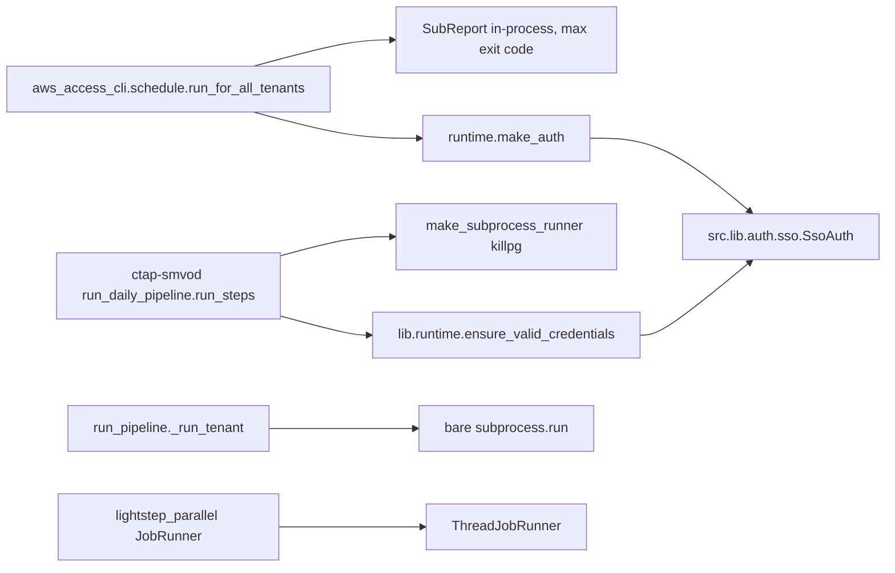
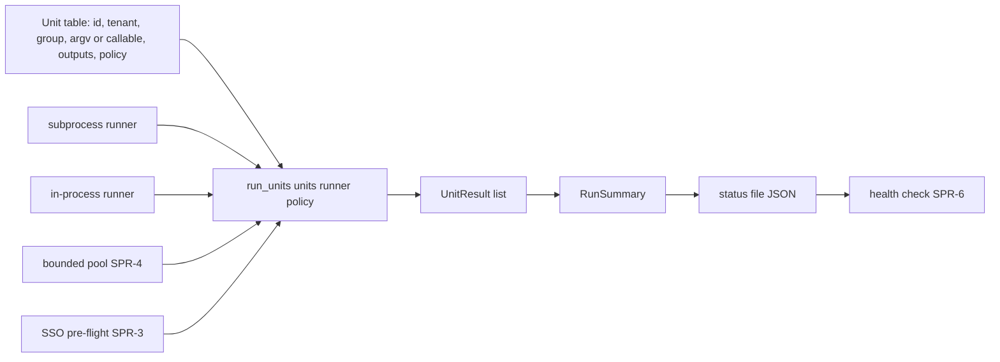

# Shared pipeline runtime — design and audit (SPR-1)

> Audit of the five orchestration copies, the target contract, and the rollout rule that keeps the live pipelines untouched until a parity-gated cutover. Docs only; awaits user approval before SPR-2.

## Rollout rule (added at plan approval, 2026-11-03)

The ctap-smvod daily wrapper and the aws-access-cli chain are live. `src/lib/pipeline_runtime/` is built **additively**: SPR-2 to SPR-6 **copy** the generic logic, they do not move it, and no legacy
file is edited (the one exception, `DEFAULT_LOG_KEEP_DAYS`, must be backward compatible for callers that pass `keep_days`). Consumers adopt it as `_v2` entry points that run in shadow beside the
legacy ones with separate output, log and status paths. Cutover follows `docs/guides/project-taxonomy.md` "Pipeline cron-cutover procedure" (PT-6): at least three consecutive matching daily runs by a
scripted diff, never a same-day swap, human-owned crontab; legacy is deleted only after that. Rollback before deletion = point cron back at the legacy entry.

## Audit (one row per concern)

| Concern | `schedule.py` (AAC) | `run_daily_pipeline.py` (LX wrapper) | `run_pipeline._run_tenant` (LX) | `lightstep_parallel.py` | SSO builders |
|---|---|---|---|---|---|
| Unit model | `SubReport(name, runner)` | `Step` / `StepResult` dataclasses | `(label, argv, skip)` tuples | job callables | n/a |
| Runner | in-process callable | subprocess, own session, `killpg`, exit 124 | bare `subprocess.run` | `Serial`/`ThreadJobRunner` | n/a |
| Timeout | none | per step (`--step-timeout-minutes`) | none | none | n/a |
| Failure policy | continue, max exit code | stop or continue per step | stop at first failure | per job | n/a |
| Run summary | none | `==== run summary ====` text block | none | none | n/a |
| Status file | none | none (log only) | none | none | n/a |
| Pool | serial tenants | serial | serial tenants (AAH-10/LX-21 want a pool) | the only pool | n/a |
| SSO | `runtime.make_auth` | via `lib/runtime.ensure_valid_credentials` | per step | n/a | two builders over `src.lib.auth.sso.SsoAuth` |

## Before (legacy, unchanged)

Production files only; tests excluded.

## Target (new, additive)

## Unit contract

- `Unit` is a frozen dataclass: `id`, `tenant`, `group`, `argv` or `call`, `outputs` (paths that must exist after success), `policy`.
- `UnitRunner` is a `Protocol`: `__call__(unit) -> RunOutcome`. Policies are data, not subclasses: `continue_on_failure`, `continue_if_outputs_exist`, `timeout_s`, `retry_if` predicate.
- Statuses: `ok | failed | timed_out | skipped`. `run_units` is the Template Method that owns start/end logging, output verification and the continue/stop decision.
- `src/lib/pipeline_runtime` imports nothing from `src/pipelines/*` or `investigations/*`.

## Timeout decision

AAC sub-reports stay **in-process** (a thread timeout cannot kill the Athena poll, the documented AAH-3 limit; keeps one Athena client per tenant for AAH-10). The LX chain uses **subprocess** (real
process-group kill, per-unit isolation, one interpreter start per unit). The runner Protocol makes this a per-consumer choice. Not measured: the cost of losing the shared Athena client if AAC ever
moves.

## Status-file schema (shared by LX-18 and AAH alerting)

`{"fcid","started","finished","exit_code","units":[{"id","tenant","group","status","exit_code","seconds","error"}]}`, written atomically (temp file + `os.replace`), overwritten per run, never pruned.
In shadow mode the v2 status path differs from legacy so health checks never read the wrong run.

## Shadow-run hazards to handle in the v2 consumers

- Existing-output skip logic: v2 must write to its own output root or it either no-ops or clobbers legacy output.
- Double API load on Athena and Lightstep (about 7-day Lightstep retention, so shadow runs need same-day data); start the v2 pool at 1 to 2 workers.
- Concurrent SSO refresh by two chains; the SPR-3 pre-flight must tolerate it.
