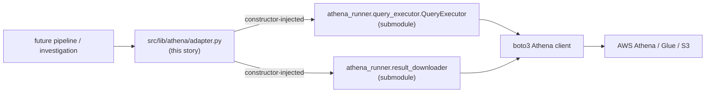
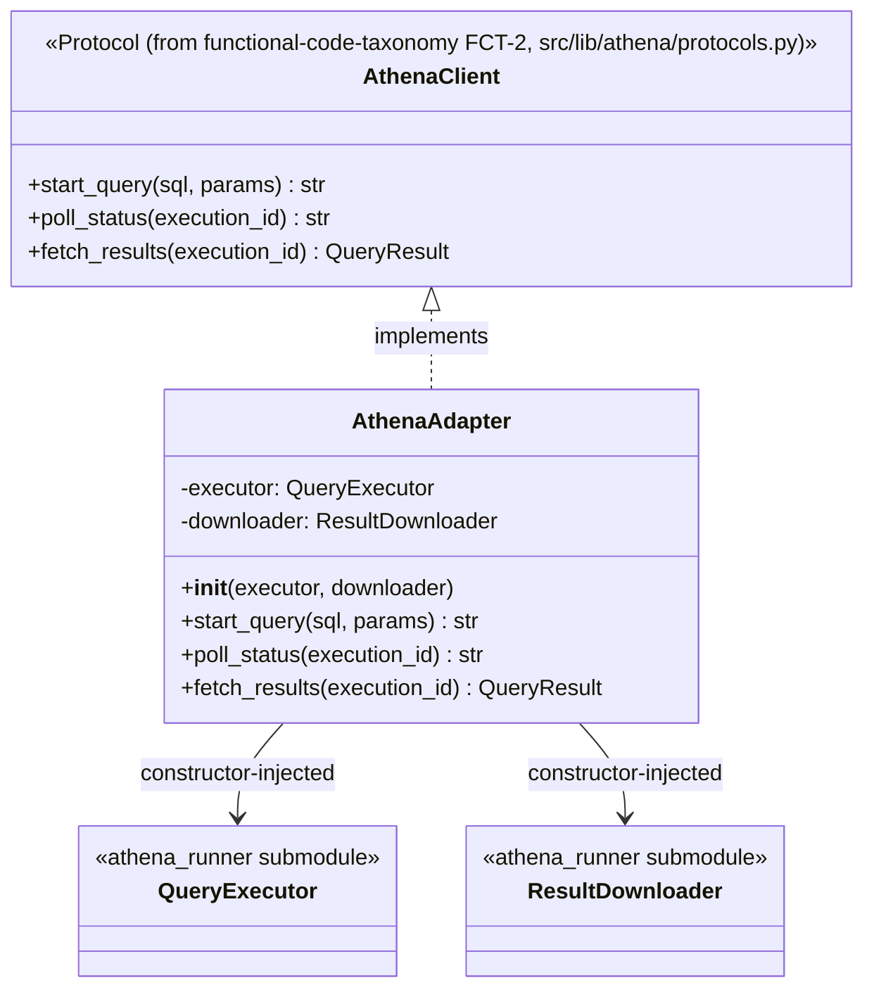
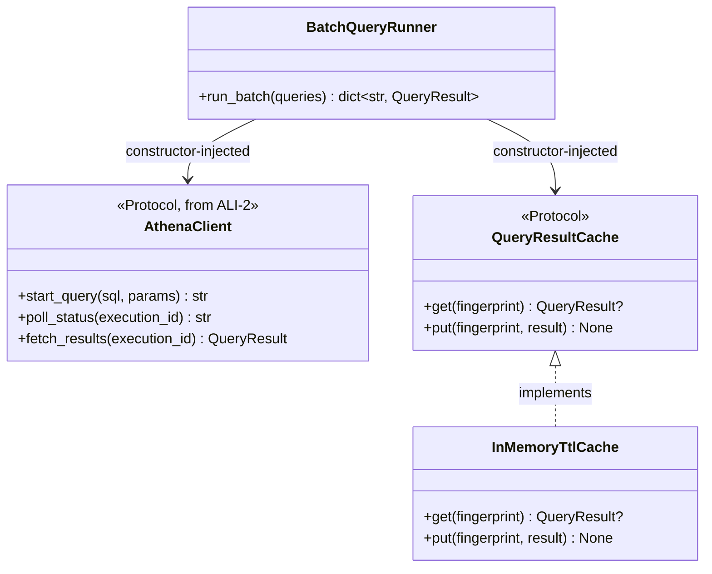
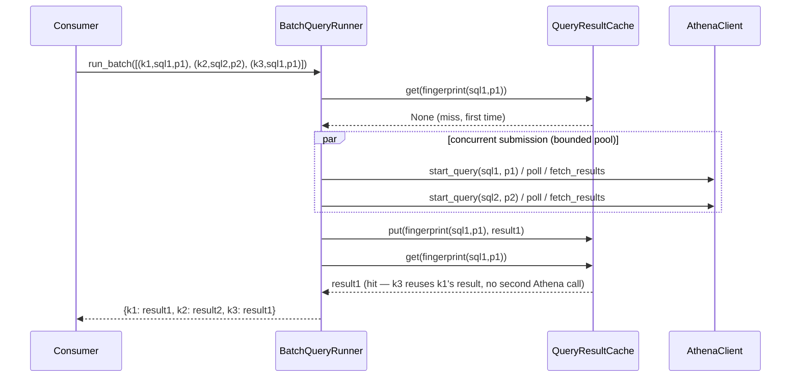

# Athena lib integration — story specs

> One task per session. Find the first unchecked item in `tasks.md`. That is your only task. Full implementation rules live in this project's `AGENTS.md` + `PYTHON_DESIGN.md`. After each task: set
> `SHA:` on the task line + tick the box, update the story status summary, add one line to your backlog/session-log file.

## Architecture — where this story sits

---

## ALI-1 — Add `athena-mcp-server` as a pinned git submodule

**Files to change / create:**
- `.gitmodules` — new `[submodule "athena-mcp-server"]` entry, path e.g. `vendor/athena-mcp-server`, url `https://github.com/abhadrasyna/athena-mcp-server.git`.
- `README.md` (project root) — add a setup step: `git submodule update --init --recursive`.
- `docs/guides/` — short note (append to an existing setup guide, or new `docs/guides/submodules.md` if none exists) on what the submodule provides and how to update its pin.

**What to implement:**

1. `git submodule add https://github.com/abhadrasyna/athena-mcp-server.git vendor/athena-mcp-server`.
2. Pin to the current `HEAD` commit of that repo at add-time (submodules pin by commit automatically — confirm the recorded SHA matches what's expected, no floating branch).
3. Document the init step and the one known open item inherited from that repo's own `CONTEXT.md` (the `aws-access-cli` sibling-checkout namespace-package merge in
   `tool_config.py::_load_mtn_registry`) as a "not this story's problem, but be aware" note — this story's adapter (ALI-2) does not touch `tool_config.py` at all, only the generic `athena_runner`
   package, precisely to avoid depending on that fragile part.

**Tests (no network, no real external services):**
- N/A — this task is repo plumbing, no test gate. Verify instead: a fresh `git clone --recurse-submodules` (or `clone` + `submodule update --init`) of `ih-trace-lab` reproduces the submodule checkout
  with no manual steps beyond the documented command.

**Commit:** `chore(athena): add athena-mcp-server as git submodule`

---

## ALI-2 — `src/lib/athena/adapter.py`: DIP-compliant adapter

**Files to change / create:**
- `src/lib/athena/adapter.py` — new file.
- `src/lib/athena/__init__.py` — package marker.

**Before writing this file:** re-read `functional-code-taxonomy` FCT-2's `src/lib/athena/protocols.py` — this adapter must implement that exact `Protocol`, not a new one invented here. If FCT-2 is not
yet landed, this task cannot start (see `prompt.md`'s hard gate).

**What to implement:**

1. `PYTHON_DESIGN.md` trigger applied: **DIP** — "a class constructs its own collaborator directly instead of receiving it." `AthenaAdapter.__init__` receives an `athena_runner.query_executor`
   instance (or a narrower `Protocol` over it) and a `result_downloader` collaborator as constructor arguments — it never calls `boto3.client(...)` or constructs `QueryExecutor()` itself.
2. Each method on `AthenaAdapter` is a one-line-to-few-line delegation to the injected `athena_runner` collaborator, translated to/from FCT-2's `Protocol` types where the shapes differ.
3. No SQL text, no per-tenant config, no `tool_config.py`-style registry logic lands here — that stays in the submodule or in a future consumer, per this epic's cross-cutting constraint ("no
   project-specific business rule in `src/lib/*`").

**Class diagram:**

<!-- 2026-10-01 pre-implementation-design-review: this diagram previously named
run_query/poll_status/download_results, which did not match src/lib/athena/protocols.py's actual AthenaClient Protocol (start_query/poll_status/fetch_results) — fixed to match the landed,
authoritative Protocol exactly. See docs/plan/pre-implementation-design-review/spec.md finding #1. -->

**Tests (no network, no real external services):**
- `test_adapter_delegates_start_query` — a fake `QueryExecutor` records the call; adapter returns its result untranslated (or correctly translated).
- `test_adapter_constructor_requires_injection` — instantiating without collaborators raises (no silent default construction of a real `boto3` client).

**Commit:** `feat(athena): add DIP-compliant adapter over athena_runner`

---

## ALI-3 — Tests: mocked `athena_runner`, `Protocol` conformance pair

**Files to change / create:**
- `tests/lib/athena/test_adapter.py` — new.
- `tests/lib/athena/test_protocol_conformance.py` — new, mirrors FCT-2's own conformance-test pattern.

**What to implement:**

1. Mock/fake `athena_runner.query_executor.QueryExecutor` and `athena_runner.result_downloader` — no real `boto3` calls, no live AWS/network, matching `athena-mcp-server`'s own existing test
   convention (mocked-boto3 unit tests).
2. `test_adapter_satisfies_protocol` — `isinstance(AthenaAdapter(fake_executor, fake_downloader), AthenaClient)` is `True`.
3. `test_non_conforming_stub_fails_protocol` — a stub missing one method is `False` under `isinstance`.
4. **DIP pair (standardized by `pre-implementation-design-review`, finding #2; see `README.md`'s cross-cutting constraints):** `test_adapter_construction_requires_collaborators` — `AthenaAdapter()`
   with no args raises `TypeError`; and `test_adapter_never_calls_boto3_directly` — assert no attribute/module lookup of `boto3` occurs from within `AthenaAdapter`'s own methods (e.g. via
   `unittest.mock.patch("boto3.client")` left un-called, or an explicit source scan), confirming all AWS access is delegated to the injected `athena_runner` collaborators.

**Commit:** `test(athena): mock athena_runner + Protocol conformance`

---

## ALI-4 — Audit: does `athena_runner` already support batch/concurrent submission?

**Added 2026-10-01 (`pre-implementation-design-review` finding #6, scoped via follow-up questions):** expected real-world shape is small batches (2-5 independent queries, e.g. a per-tenant or per-day
fan-out) run together sometimes, plus a need to cache results when the identical SQL+params re-runs. Existing-support status was unknown going in — this task resolves that before any design/code is
written.

**Files to change / create:**
- `stories.md` (this file) — record the finding as a subsection under ALI-5 below, before writing any code.

**What to implement:**

1. Read the `athena-mcp-server` submodule's `athena_runner.query_executor.QueryExecutor` (and any sibling batch/pool helper) for existing concurrent-submission or result-caching support.
2. Record the finding: either cite the existing helper to delegate to (ALI-5 then wraps it, does not reimplement it), or state explicitly that none exists and ALI-5 is net-new design.

**Tests:** N/A — audit/analysis task, no code changes.

**Commit:** `docs(athena): confirm athena_runner batch/cache support status`

---

## ALI-5 — `src/lib/athena/batch.py`: concurrent batch submission + TTL result cache

**Files to change / create:**
- `src/lib/athena/batch.py` — new.
- `src/lib/athena/cache.py` — new.

**What to implement:**

1. `PYTHON_DESIGN.md` triggers applied: **DIP** (both new classes take their collaborators via constructor injection, matching ALI-2's adapter pattern — no direct `athena_runner`/`boto3` access) and
   **Strategy** (the cache is a swappable `Protocol`, not hardcoded to one storage backend).
2. `QueryResultCache` (`Protocol`, `@runtime_checkable`) in `cache.py`: `get(fingerprint: str) -> QueryResult | None`, `put(fingerprint: str, result: QueryResult) -> None`. `fingerprint_query(sql:
   str, params: Mapping[str, str]) -> str` — a free function hashing `(sql, tuple(sorted(params.items())))`, so two calls with the same SQL text and the same params (regardless of dict insertion
   order) collide to the same cache key.
3. `InMemoryTtlCache` in `cache.py` implementing `QueryResultCache`: constructor takes `ttl_seconds: int` (required, no silent default — per this epic's DIP-pair test convention); internally stores
   `{fingerprint: (QueryResult, inserted_at)}`; `get()` returns `None` and evicts the entry if `now - inserted_at > ttl_seconds`.
4. `BatchQueryRunner` in `batch.py`: constructor takes an `AthenaClient` (ALI-2's adapter) and a `QueryResultCache` — both required collaborators, never constructed internally. `run_batch(queries:
   Sequence[tuple[str, str, Mapping[str, str]]]) -> dict[str, QueryResult]` — each tuple is `(caller_key, sql, params)`; caller keys let the caller correlate results back to its own request list
   regardless of completion order.
5. Concurrency: use `concurrent.futures.ThreadPoolExecutor` (I/O-bound — waiting on Athena network calls, not CPU-bound work) with a bounded `max_workers` (constructor arg, default small e.g. 5,
   matching the confirmed small-batch shape — document that larger fan-outs should revisit this default rather than assuming it scales unbounded).
6. Cache-first flow per query: compute `fingerprint_query(sql, params)`; on cache hit, skip `start_query`/polling entirely; on miss, submit via the injected `AthenaClient`, poll to completion, store
   the result in the cache, then return it.
7. No query silently swallows a failure — if one query in the batch raises, record which `caller_key` failed (do not let one failure silently blank out the whole batch's results); exact exception
   propagation strategy (fail-fast vs. partial results) is this task's own design choice to make and document in a code comment, since both are defensible and the project's investigation workflows are
   not CPU-tight enough to mandate one over the other up front.

**Class diagram:**

**Sequence diagram (batch of 3, one cache hit):**

**Tests:**
- `test_batch_runner_construction_requires_collaborators` — `BatchQueryRunner()` with no args raises `TypeError` (DIP pair, per this epic's standardized convention).
- `test_fingerprint_is_stable_regardless_of_param_order` — `fingerprint_query(sql, {"a": "1", "b": "2"})` equals `fingerprint_query(sql, {"b": "2", "a": "1"})`.
- `test_cache_hit_skips_athena_call` — second identical query in a batch never calls the fake `AthenaClient`'s `start_query`.
- `test_ttl_cache_expires_entry` — `get()` returns `None` after `ttl_seconds` has elapsed (use a fake/injectable clock, not real `time.sleep`).
- `test_run_batch_preserves_caller_keys` — result dict keys match the caller-supplied keys, not submission or completion order.
- `test_one_query_failure_does_not_silently_blank_others` — one fake `AthenaClient` raising for one query still yields correct results for the other `caller_key`s (exact propagation shape per this
  task's documented choice).

**Commit:** `feat(athena): add concurrent batch submission + TTL result cache`

---

## ALI-6 — Doc/`CONTEXT.md` pointers

**Files to change / create:**
- `CONTEXT.md` — one new "What Exists" line for this story.
- Project root `README.md` (or `docs/guides/`) — submodule init step, if not already covered by ALI-1.
- `docs/plan/src-lib-migration/README.md` — update this story's row in the "Stories" status table to ✅ Done with closing SHA (final task of the story).

**What to implement:**

1. `CONTEXT.md` line: `src/lib/athena/adapter.py` — thin DIP adapter over the `athena-mcp-server` git submodule's `athena_runner` package; no Athena execution logic duplicated in `ih-trace-lab`.
2. `CONTEXT.md` line: `src/lib/athena/batch.py` + `cache.py` — bounded-concurrency batch submission with a shape-keyed-by-fingerprint TTL result cache, for consumers submitting multiple independent
   queries (e.g. per-tenant/per-day fan-out).
3. Confirm no drift: re-read `docs/plan/src-lib-migration/README.md`'s Supersession/coordination note and confirm it still accurately describes the landed state.

**Tests:** N/A — docs only.

**Commit:** `docs(athena): point CONTEXT.md at the new adapter + batch/cache layer`
