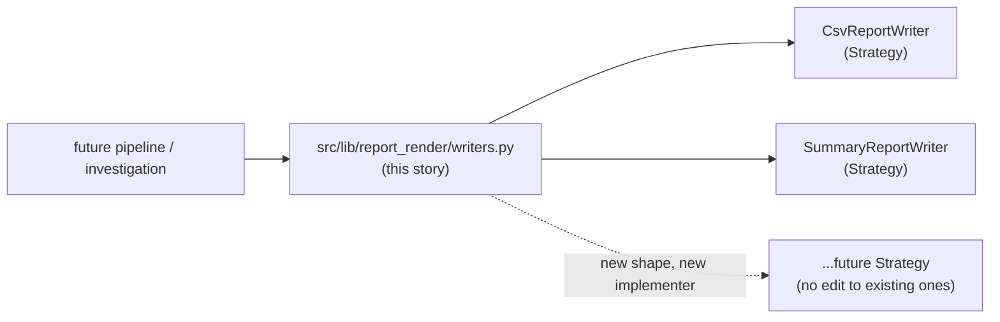
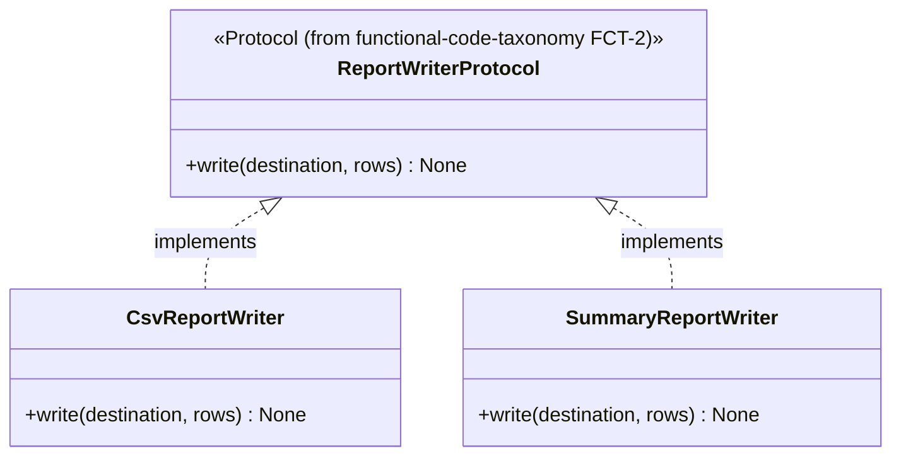
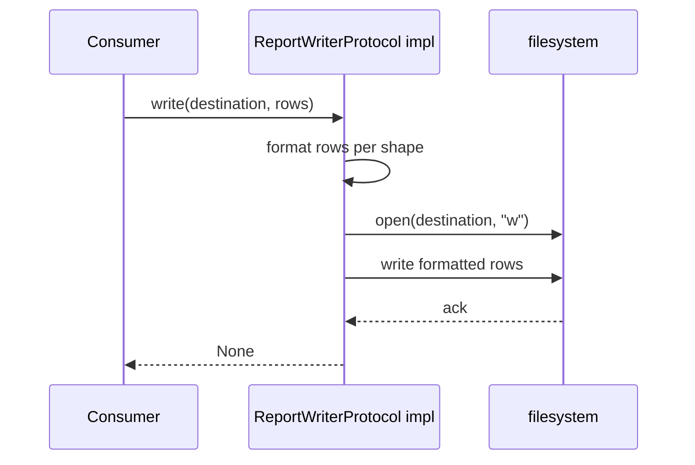
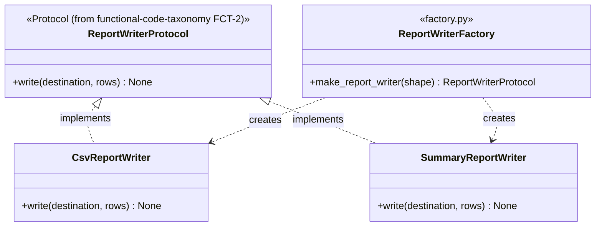

# Report render lib migration — story specs

> One task per session. Find the first unchecked item in `tasks.md`. That is your only task. After each task: set `SHA:` on the task line + tick the box, update the story status summary, add one line
> to your backlog/session-log file.

## Architecture — where this story sits

---

## RRM-1 — Re-confirm audit list, group by shape

**Status: DONE (requester-approved 2026-10-02) — satisfies this task's STOP gate, pre-implementation sign-off.** RRM-2 may proceed directly against the grouping below without re-auditing.

### Audit findings

Read-only audit across the five `functional-code-taxonomy` FCT-1-cited projects found 18 relevant files, not the original "8+" estimate; 13 are `csv_io`'s (see
`docs/plan/src-lib-migration/csv-io-lib-migration/stories.md` CIM-1). The remaining 5 are `report_render`'s, grouped into **3 Strategy shapes**:

**Shape 1 — `MarkdownTableWriter`** (flat markdown table, one row per event/item):
- `github_copilot/vod-playback-timing-probe/scripts/generate_timing_report.py`
- `github_copilot/vod-playback-timing-probe/scripts/playback_probe/har_probe_comparison_report.py`

**Shape 2 — `CategoryBreakdownWriter`** (counts by category + most-common top-N; markdown-file and console-print are a *destination* difference, handled by the writer's path/file-handle contract, not
a separate shape):
- `github_copilot/mtn-zm-session-device-investigation/scripts/generate_summary.py`
- `github_copilot/mtn-zm-session-device-investigation/scripts/summarize_final_session_report.py`

**Shape 3 — `StatisticalWriteupWriter`** (richer multi-section write-up: distribution + buffering/startup stats + outliers + breakdowns + anomaly scan — structurally distinct from Shape 2, not merged
with it):
- `github_copilot/ctap-smvod-session-report/scripts/analyze_outcome_report.py`

`src/lib/report_render/writers.py` (RRM-2) implements exactly these 3 Strategy classes — no more, no fewer — covering all 5 cited originals.

**Files changed:** none — this section of `stories.md` is itself the task's deliverable, recorded here by prior agreement rather than produced by a dedicated commit.

**Tests:** N/A — audit/analysis task, no code changes.

**Commit:** `docs(report_render): confirm writer audit, group by shape`

---

## RRM-2 — `src/lib/report_render/writers.py`: Strategy implementer(s)

**Files to change / create:**
- `src/lib/report_render/writers.py` — new.
- `src/lib/report_render/__init__.py` — package marker.

**Before writing this file:** re-read `functional-code-taxonomy` FCT-2's `src/lib/report_render/protocols.py` — implement that `Protocol` exactly, do not invent a new one.

**What to implement:**

1. `PYTHON_DESIGN.md` trigger applied: **OCP** — "adding a new report format is a new copy-pasted `to_csv`/print-loop." Instead: one Strategy implementer class per shape from RRM-1's list, each
   satisfying FCT-2's `Protocol`; a new shape in future is a new implementer class, never an edited existing one.
2. Each implementer takes its output target (file handle or path) and row data via method arguments — no implementer opens its own file path from a hardcoded/global location (keeps it
   project-agnostic, matches the "no project-specific business rule in `src/lib/*`" cross-cutting constraint).

**Class diagram:**

**Sequence diagram (typical write flow):**

**Tests (no network, no real external services):**
- `test_csv_writer_writes_expected_rows` — temp file, assert exact content.
- `test_summary_writer_includes_subtotals` — temp file, assert subtotal rows present.

**Commit:** `feat(report_render): add Strategy-based report writers`

---

## RRM-3 — `src/lib/report_render/factory.py`: writer selection Factory

**Files to change / create:**
- `src/lib/report_render/factory.py` — new.
- `src/lib/report_render/protocols.py` — re-read (do not edit) FCT-2's `ReportWriterProtocol`; this task adds a sibling, not a replacement.

**Why this task exists (2026-10-01, `pre-implementation-design-review` finding #4):** RRM-2 defines one Strategy implementer per report shape but leaves selection between them to each consumer — every
call site would need its own `if shape == "csv": CsvReportWriter() else: SummaryReportWriter()` branch, which is exactly the OCP violation RRM-2 was meant to close, just moved to the call sites
instead of removed. This task closes that gap with a Factory Method so consumers depend only on a shape key, never on a concrete writer class name.

**What to implement:**

1. `PYTHON_DESIGN.md` trigger applied: **Factory Method** — one function owns "which `ReportWriterProtocol` implementer corresponds to this shape key," so adding a new shape is a one-line registry
   entry, never an edited `if`/`elif` chain at every call site.
2. `REPORT_SHAPE_REGISTRY: dict[str, type[ReportWriterProtocol]]` module-level mapping from a shape key (the same shape names RRM-1 recorded, e.g. `"csv"`, `"summary"`) to its writer class.
3. `make_report_writer(shape: str) -> ReportWriterProtocol` — looks up `REPORT_SHAPE_REGISTRY[shape]`, instantiates it, and raises a clear `ValueError` (listing valid keys) for an unknown shape —
   never a silent `None`/default fallback.
4. No consumer imports `CsvReportWriter`/`SummaryReportWriter` directly going forward — `RRM-4`'s doc pointer should say so explicitly so future consumers use the factory, not the concrete classes.

**Class diagram:**

**Tests:**
- `test_make_report_writer_returns_csv_writer` — `make_report_writer("csv")` is an instance of `CsvReportWriter`.
- `test_make_report_writer_returns_summary_writer` — `make_report_writer("summary")` is an instance of `SummaryReportWriter`.
- `test_make_report_writer_unknown_shape_raises` — `make_report_writer("nonsense")` raises `ValueError` listing valid keys.

**Commit:** `feat(report_render): add Factory Method for writer selection`

---

## RRM-4 — Tests + `Protocol` conformance pair

**Files to change / create:**
- `tests/lib/report_render/test_writers.py` — new.
- `tests/lib/report_render/test_protocol_conformance.py` — new.

**What to implement:**

1. `test_conforming_writer_satisfies_protocol` — `isinstance(CsvReportWriter(), ReportWriterProtocol)` is `True`.
2. `test_non_conforming_stub_fails_protocol` — a stub missing `write` is `False`.
3. All writer tests use `tmp_path` (pytest fixture) — no real project directories touched.

**Commit:** `test(report_render): writer tests + Protocol conformance`

---

## RRM-5 — Doc/`CONTEXT.md` pointers

**Files to change / create:**
- `CONTEXT.md` — one new "What Exists" line.
- `docs/plan/src-lib-migration/README.md` — update this story's row to ✅ Done with closing SHA.

**What to implement:**

1. `CONTEXT.md` line: `src/lib/report_render/writers.py` + `factory.py` — Strategy-based report writers, selected via a Factory Method keyed by shape, replacing the 8+ duplicated `github_copilot`
   originals (cite RRM-1's grouped list).
2. Note explicitly that future consumers call `make_report_writer(shape)`, never import a concrete writer class directly.

**Tests:** N/A — docs only.

**Commit:** `docs(report_render): point CONTEXT.md at the new writers + factory`
