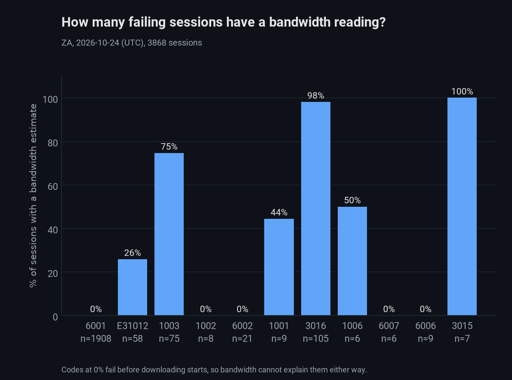
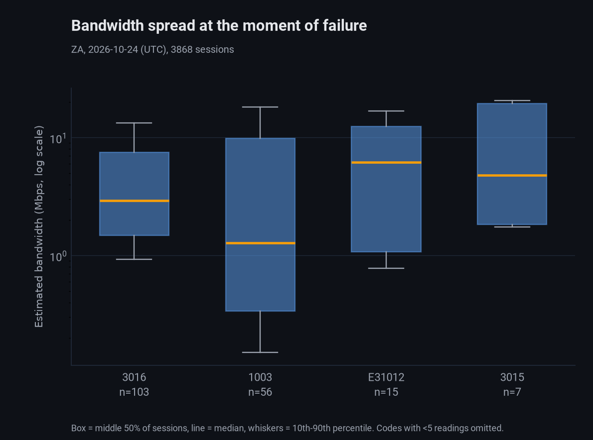
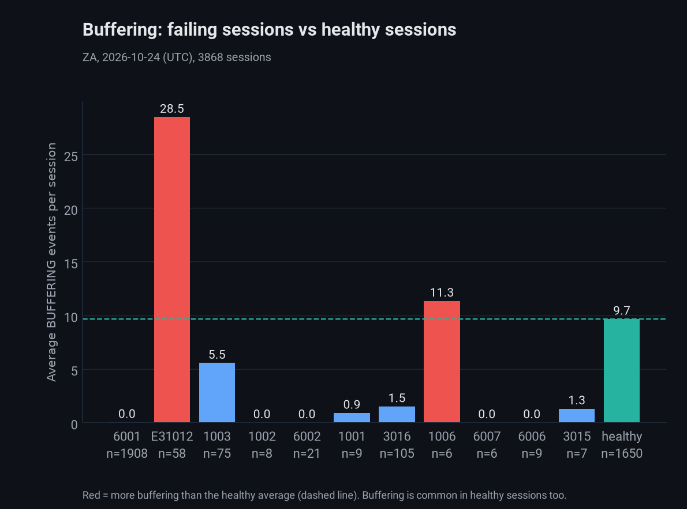
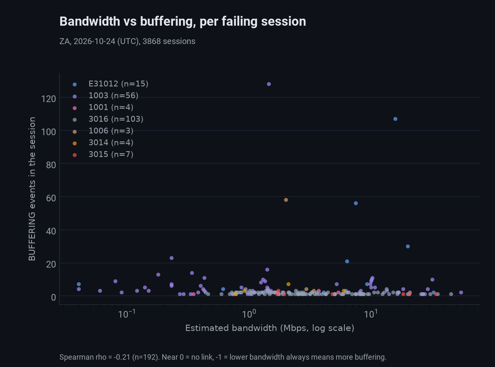
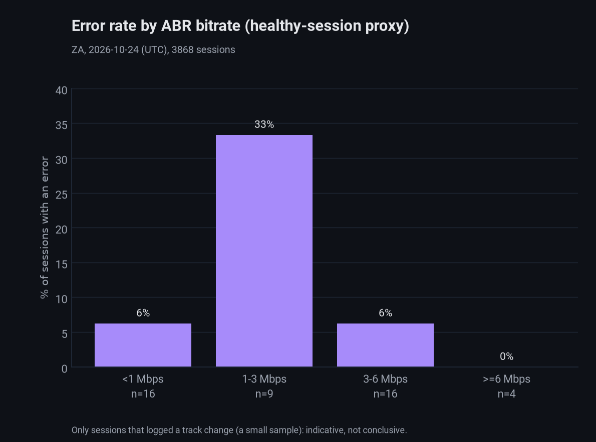

# ZA 2026-10-24: is low bandwidth causing the playback failures?

Hypothesis: playback fails because viewers have low bandwidth. Data: every `PLAYER_ERROR`, `PLAYER_BUFFER_LEVEL`, `PLAYER_STATE_CHANGE` and `PLAYER_TRACK_CHANGE` debug event of the day for ZA, joined
per `sessionid` (3,868 sessions: 2,218 with at least one error, 1,650 without). Produced by `run_athena_session_bandwidth.py` -> `analyze_bandwidth_vs_failure.py` -> `chart_bandwidth_vs_failure.py`
(see `docs/usage.md`).

## Summary

The data does not support "low bandwidth is the main cause". Most failures happen before any video is downloaded, and for the failures that do happen mid-playback the link between bandwidth and
failure is weak.

## Why so many failures? (plain-language)

| Error | Sessions | Share of error sessions | What is going wrong | Bandwidth involved? |
|---|---|---|---|---|
| 6001 | 1,908 | 86% | DRM cannot start (`REQUESTED_KEY_SYSTEM_CONFIG_UNAVAILABLE`): mostly Android WebView reporting Widevine unavailable. Fails at LOADING, before any download. | No: no reading |
| 3016 | 105 | 4.7% | The video decoder fails (`PIPELINE_ERROR_DECODE`), mostly while seeking. Median bandwidth was about 3.7 times the stream bitrate, so the connection was fast enough. | Unlikely |
| 1003 | 75 | 3.4% | Network or host fetch failures (SSAI and CDN hosts, per Option A). The only code with a very low-bandwidth tail (p10 0.14 Mbps). | Plausible for part |
| E31012 | 58 | 2.6% | Heavy stalling: 28 BUFFERING events per session on average. Median bandwidth is a healthy 6.2 Mbps, but only 15 of 58 sessions logged a reading. | Unclear |
| all others | 72 | 3.2% | Small codes (6002, 1001, 6006, 1002, 3015, 1006, 6007, 3014, 6008). | Mostly no data |

So roughly nine in ten failures are a device/DRM compatibility problem, not a network problem. Fixing 6001 would remove most of the failure volume regardless of bandwidth.

Counts differ from `docs/plan/conviva-metrics-recreation/vsf-technical/2026-10-24_ZA_vsf-technical-error-summary-optionA.md` (2,101 sessions) because that report covers VSF-T sessions matched to
Lightstep, while this one covers every session in the tenant's debug-events table for the day.

## Statistics, explained simply

| Term | What it means here |
|---|---|
| Estimated bandwidth | Shaka's `estimatedbandwidth` (Mbps): the player's own guess of download speed. Only logged on a `PLAYER_ERROR`; empty when the failure came before downloading started. |
| Coverage | The share of a code's sessions that have a bandwidth reading at all. 0% means bandwidth cannot be tested for that code. |
| p10 / p50 / p90 | Sort readings slowest to fastest. p50 (median) is the middle; 10% of sessions are below p10, 90% below p90. A wide p10-to-p90 gap means bandwidth varies a lot. |
| Box plot | The box is the middle 50% of sessions, the orange line is the median and the whiskers show p10 and p90. A taller box means more spread. |
| Headroom | Estimated bandwidth divided by the stream's bitrate. Above 1 means the connection could keep up; below 1 means it could not. |
| Spearman correlation (rho) | Do two things move together? -1 to +1, by ranking. -1: lower bandwidth always means more buffering. 0: no link. +1: the opposite. About -0.2 is weak. |
| Mann-Whitney test | Does one group tend to have higher values than another? The p-value is the chance of a difference this big by luck: below 0.05 is "probably real", above is "could be luck". |
| ABR bitrate | The quality level the player chose (`PLAYER_TRACK_CHANGE`). Lower bandwidth means lower quality, so it stands in for bandwidth in healthy sessions, which have no estimate. |
| n | The number of sessions behind a number. Small n (under about 30) is indicative only. |

## Results

### Which failures even have a bandwidth reading?



6001 (and 6002, 6006, 6007, 6008, 1002) have 0%: they fail before downloading starts. Only 3016 (98%), 3015 (100%), 3014 (100%), 1003 (75%) and 1006/1001 (about 50%) can be tested.

### How much does bandwidth vary at the moment of failure?



| Code | n with bandwidth | p10 | p50 | p90 (Mbps) |
|---|---|---|---|---|
| 3016 | 103 | 0.87 | 2.9 | 13.9 |
| 1003 | 56 | 0.15 | 1.3 | 19.3 |
| E31012 | 15 | 0.68 | 6.2 | 18.7 |
| 3015 | 7 | 1.7 | 4.8 | 25.9 |

The spread is huge inside every code (p90 is 15 to over 100 times p10). That means failing sessions come from both slow and fast connections, which argues against a single "low bandwidth" cause. Only
1003 has a median near 1 Mbps.

### Do failing sessions buffer more than healthy ones?



Healthy sessions already average 9.7 BUFFERING events and 37% have three or more, so buffering alone is not a failure signal. Only E31012 (28.5, 71% with three or more) and 1006 (n=6) stand out. 1003
is below the healthy average (5.5) but 49% of its sessions have three or more.

### Is lower bandwidth linked to more buffering in failing sessions?



Spearman rho is -0.21 over 192 failing sessions that have an estimate: a weak link at best. Per code: 3016 -0.27 (n=103), 1003 -0.09 (n=56, effectively none), E31012 +0.26 (n=15, the wrong direction).
Most dots sit near zero buffering at every bandwidth; the few heavy-buffering sessions are spread across the whole range, including fast connections.

### Healthy-session comparison (small sample)



Only 45 sessions logged an ABR bitrate (5 failing, 40 healthy). Median bitrate was 2.28 Mbps for failing sessions and 2.22 Mbps for healthy ones (Mann-Whitney p = 0.72), i.e. no detectable difference.
The 1-3 Mbps bucket has the highest error rate (3 of 9) but the sample is too small to conclude anything.

### Network type

`navigator.connection.effectivetype` is present even when Shaka's estimate is empty. 6001 is 99.6% 4g, so it is not a slow-network problem. 3G or slower is over-represented in the others: 1003 (43% 3g
or slower), 3016 (34%) and E31012 (38%). There is no healthy-session network baseline, so this is a hint, not proof (`2026-10-24_effectivetype_by_errorcode.csv`).

## What this does and does not prove

- Not proven: that low bandwidth causes failures. Not disproven for 1003 and E31012, where a slow-connection subset exists but the evidence is thin.
- Healthy sessions have no Shaka bandwidth estimate, so the key comparison (failure rate by bandwidth) cannot be made properly. The ABR proxy covers only 45 sessions.
- `PLAYER_BUFFER_LEVEL` `level.cur` is 0 in every session, healthy or failing, so buffer depth cannot be used. This looks like a player logging bug.
- One day and one tenant. Association is not causation: device type, network and content are tangled together.

## Recommended next steps

1. Player team: log `estimatedbandwidth` periodically on healthy sessions (for example on `PLAYER_BUFFER_LEVEL` or `PLAYER_POSITION`), and fix `level.cur`. This is what would settle the hypothesis.
2. Fix or work around 6001 (Widevine unavailable in Android WebView): it is 86% of the failure volume.
3. For 3016 (decode), look at device and codec rather than bandwidth.
4. Re-run for more days and for GH/ZM: `run_athena_session_bandwidth.py --date <d> --tenant <T>` then the analyze and chart scripts.

## Reproduce

```bash
cd investigations/ctap-smvod/scripts
python3 run_athena_session_bandwidth.py --date 2026-10-24 --tenant ZA      # data/athena/ZA/2026-10-24_session_bandwidth.csv
python3 analyze_bandwidth_vs_failure.py --date 2026-10-24 --tenant ZA       # output/ZA/bandwidth/*.csv
python3 chart_bandwidth_vs_failure.py --date 2026-10-24 --tenant ZA         # output/ZA/charts/2026-10-24_*.png (copied to docs/img/)
```
