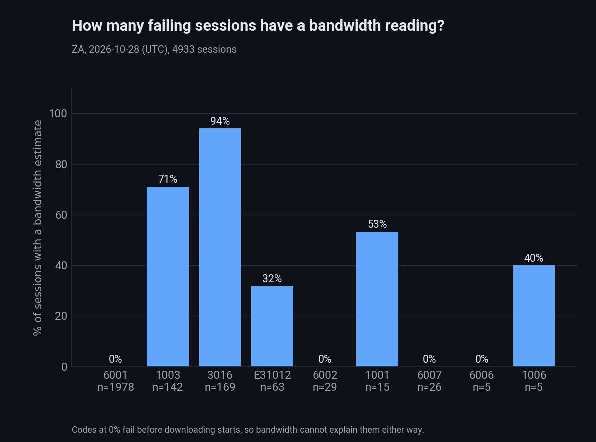
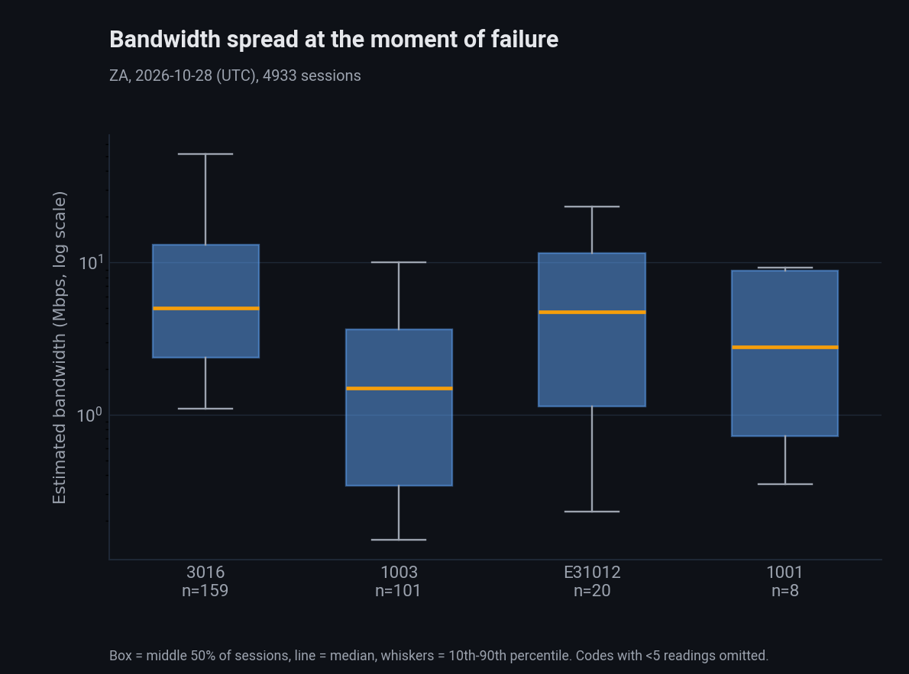
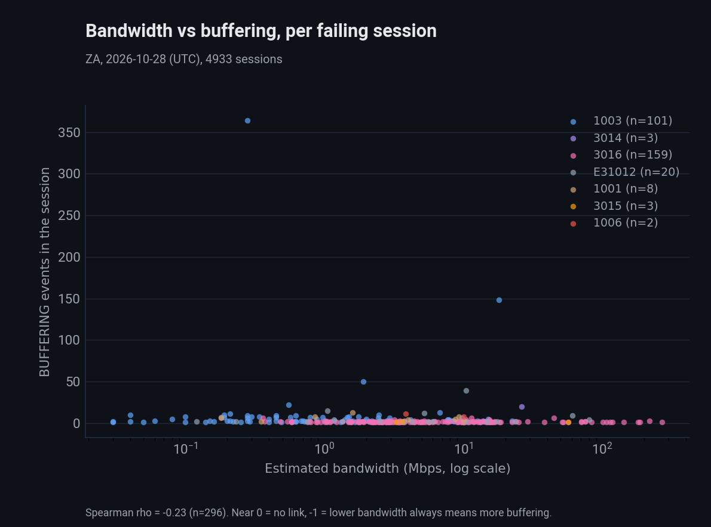
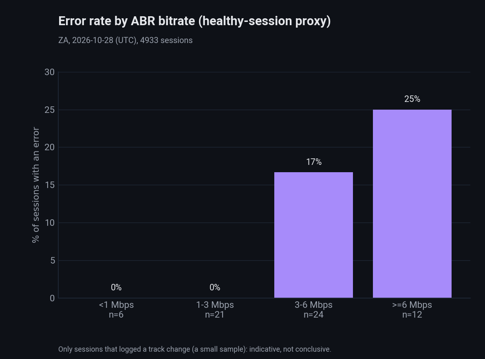

# ZA 2026-10-28: is low bandwidth causing the playback failures?

Same method and term definitions as `2026-10-29_ZA_bandwidth-vs-playback-failure.md` (which analyses 2026-10-24). Live Athena run on 2026-10-30 via `run_athena_session_bandwidth.py` ->
`analyze_bandwidth_vs_failure.py` -> `chart_bandwidth_vs_failure.py`. 4,933 sessions: 2,444 with at least one error, 2,489 without.

## Summary

Again not supported as the main cause. 81% of error sessions are 6001 (DRM, no bandwidth reading). Where bandwidth exists the link to buffering is weak (rho -0.23, n=296), and the ABR proxy points the
opposite way: failing sessions had a higher bitrate (median 5.3 vs 3.6 Mbps, p=0.007, but only 7 failing sessions).

## Error mix

| Error | Sessions | Share | With bandwidth | p10 / p50 / p90 (Mbps) | Avg BUFFERING events |
|---|---|---|---|---|---|
| 6001 | 1,978 | 81% | 0% | n/a | 0.02 |
| 3016 | 169 | 6.9% | 94% | 1.1 / 5.0 / 51.8 | 1.5 |
| 1003 | 142 | 5.8% | 71% | 0.15 / 1.5 / 10.0 | 6.7 |
| E31012 | 63 | 2.6% | 32% | 0.23 / 4.7 / 27.1 | 14.3 |
| 6002 | 29 | 1.2% | 0% | n/a | 0 |
| 6007 | 26 | 1.1% | 0% | n/a | 0 |
| others | 37 | 1.5% | mixed | n/a | n/a |
| healthy baseline | 2,489 | n/a | 0% | n/a | 7.9 (40% have 3+) |

## Results

- Only 3016, 3015, 3014, 1003 and about half of 1001/1006 can be tested; 6001/6002/6006/6007/6008/1002 fail before downloading.
- 3016: median 5.0 Mbps, 5.8x the stream bitrate, so the link was fast enough; Spearman vs buffering -0.01 (none).
- 1003: the only code with a slow tail (p10 0.15 Mbps, median 1.5); Spearman -0.15 (weak). Median headroom 1.7.
- E31012: heavy stalling (14.3 events, 62% with 3+) at a median 4.7 Mbps; only 20 of 63 sessions have a reading, so unclear.
- Overall Spearman bandwidth vs buffering in failing sessions: -0.23 (n=296), weak.
- ABR error rate by bucket (tiny n): <1 Mbps 0/6, 1-3 0/21, 3-6 4/24, >=6 3/12. Higher-bitrate sessions failed more, the reverse of the hypothesis; prob. a failing session has lower bitrate than a
  healthy one is 0.19.

    

## Caveats

Same as the 24 Oct report: healthy sessions have no Shaka estimate, the ABR proxy covers only 63 sessions, and one day/one tenant shows association, not causation. Effective-type breakdown is in
`output/ZA/bandwidth/2026-10-28_effectivetype_by_errorcode.csv` (local, gitignored).

## Reproduce

```bash
cd investigations/ctap-smvod/scripts
python3 run_athena_session_bandwidth.py --date 2026-10-28 --tenant ZA
python3 analyze_bandwidth_vs_failure.py --date 2026-10-28 --tenant ZA
python3 chart_bandwidth_vs_failure.py --date 2026-10-28 --tenant ZA
```
