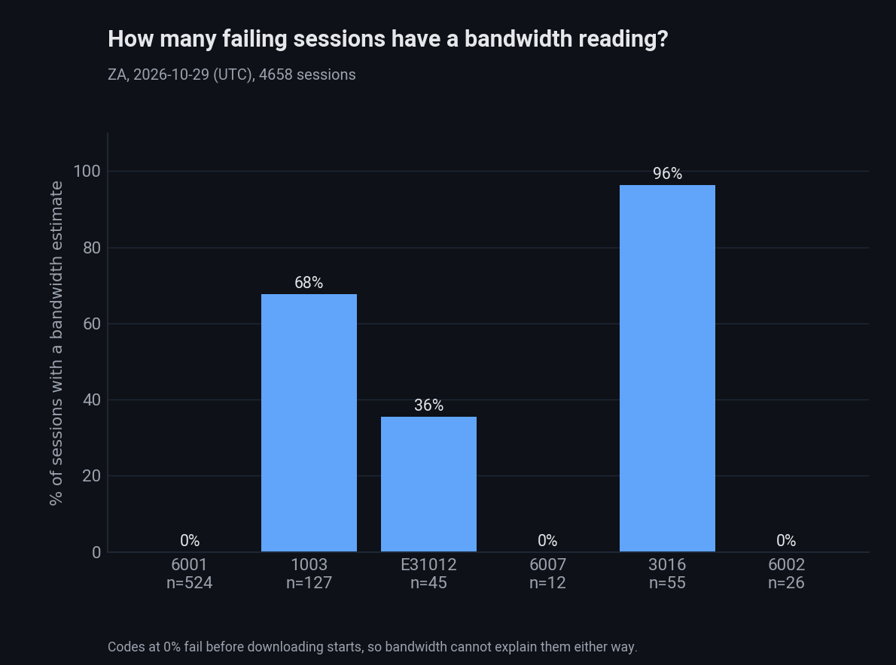
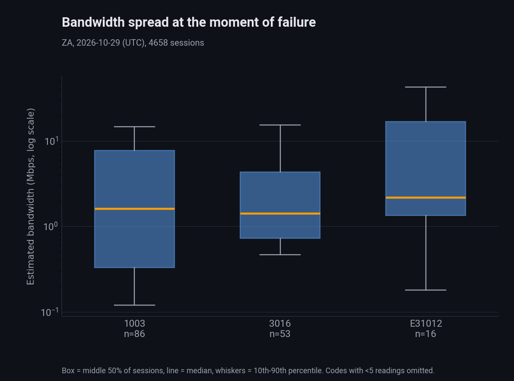
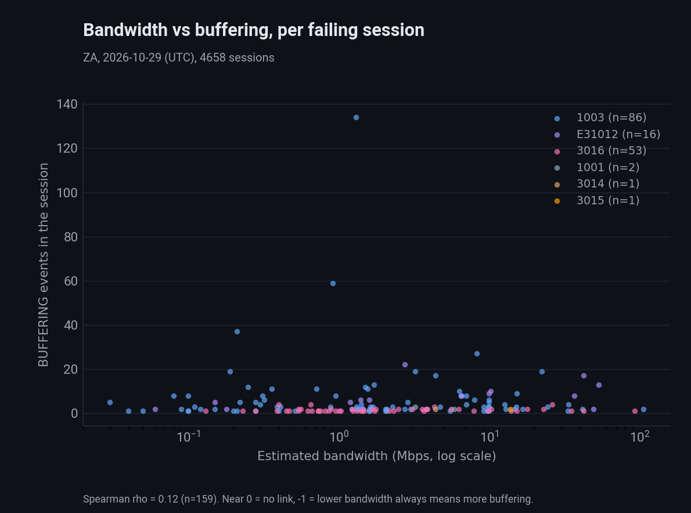
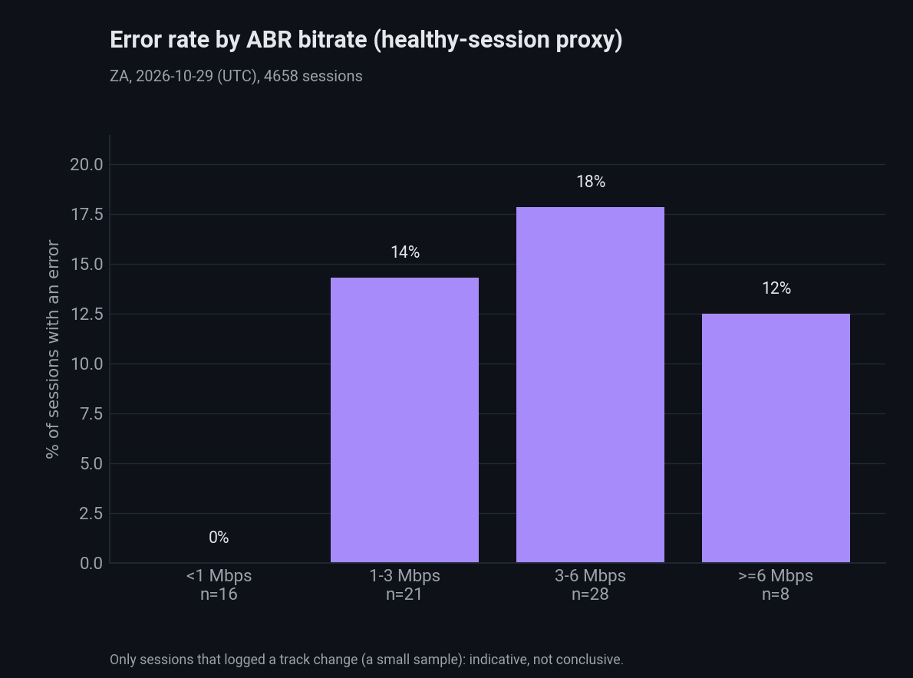

# ZA 2026-10-29: is low bandwidth causing the playback failures?

Same method and term definitions as `2026-10-29_ZA_bandwidth-vs-playback-failure.md` (which analyses 2026-10-24). Live Athena run on 2026-10-30 via `run_athena_session_bandwidth.py` ->
`analyze_bandwidth_vs_failure.py` -> `chart_bandwidth_vs_failure.py`. 4,658 sessions: 799 with at least one error, 3,859 without.

## Summary

Not supported as the main cause. 6001 (DRM, no bandwidth reading) is still the largest error, but its volume fell sharply versus 28 Oct (524 vs 1,978 sessions), so the error rate dropped from 50% to
17% of sessions. Among codes with a bandwidth reading, 1003 now outnumbers 3016 and is the only one with a clear slow-connection component. Bandwidth vs buffering is not negatively linked (rho +0.12,
n=159).

## Error mix

| Error | Sessions | Share | With bandwidth | p10 / p50 / p90 (Mbps) | Avg BUFFERING events |
|---|---|---|---|---|---|
| 6001 | 524 | 66% | 0% | n/a | 0.01 |
| 1003 | 127 | 16% | 68% | 0.12 / 1.6 / 14.9 | 5.0 |
| 3016 | 55 | 6.9% | 96% | 0.45 / 1.4 / 17.5 | 1.5 |
| E31012 | 45 | 5.6% | 36% | 0.17 / 2.2 / 45.8 | 12.2 |
| 6002 | 26 | 3.3% | 0% | n/a | 0.8 |
| 6007 | 12 | 1.5% | 0% | n/a | 0.08 |
| others | 10 | 1.3% | mixed | n/a | n/a |
| healthy baseline | 3,859 | n/a | 0% | n/a | 6.9 (25% have 3+) |

## Results

- 3016 median bandwidth fell to 1.4 Mbps (5.0 on 28 Oct) with p10 0.45, yet median headroom is still 2.9x; Spearman vs buffering +0.21 (wrong direction for the hypothesis).
- 1003: median 1.6 Mbps, p10 0.12; Spearman +0.03 (none). Slow tail exists but does not track buffering.
- E31012: 12.2 BUFFERING events, 69% with 3+; Spearman +0.59 (n=16), the opposite of "lower bandwidth, more buffering", so small-sample noise or another cause.
- Overall Spearman bandwidth vs buffering in failing sessions: +0.12 (n=159), no link.
- ABR error rate by bucket (tiny n): <1 Mbps 0/16, 1-3 3/21, 3-6 5/28, >=6 1/8. Failing median 4.9 Mbps vs healthy 2.6, p=0.093 (not significant; n=9 failing).

    

## Caveats

Same as the 24 Oct report: healthy sessions have no Shaka estimate, the ABR proxy covers only 73 sessions, and one day/one tenant shows association, not causation. The cause of the 6001 drop between
28 and 29 Oct is not investigated here. Effective-type breakdown is in `output/ZA/bandwidth/2026-10-29_effectivetype_by_errorcode.csv` (local, gitignored).

## Reproduce

```bash
cd investigations/ctap-smvod/scripts
python3 run_athena_session_bandwidth.py --date 2026-10-29 --tenant ZA
python3 analyze_bandwidth_vs_failure.py --date 2026-10-29 --tenant ZA
python3 chart_bandwidth_vs_failure.py --date 2026-10-29 --tenant ZA
```
