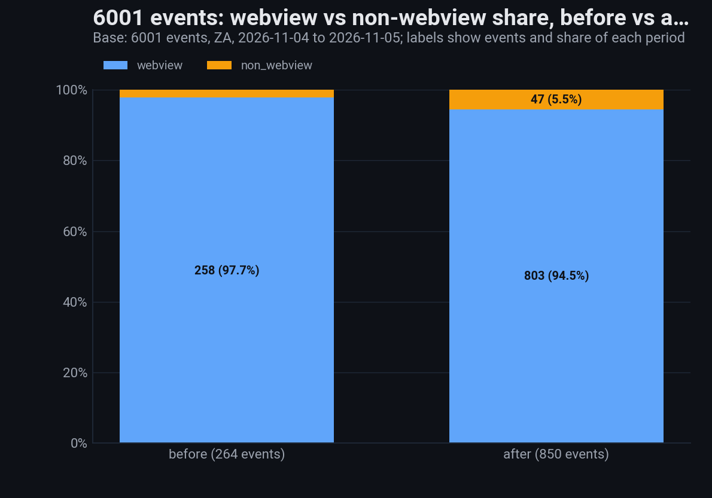
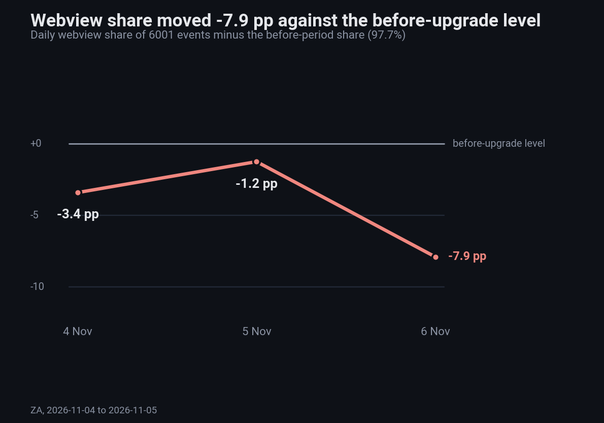
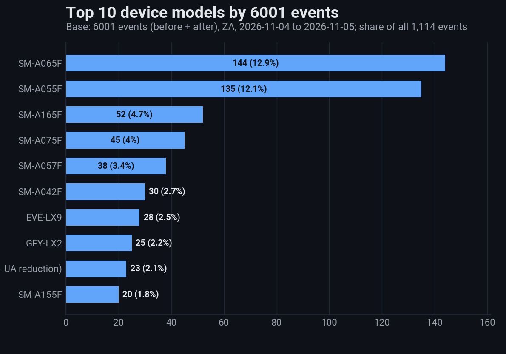
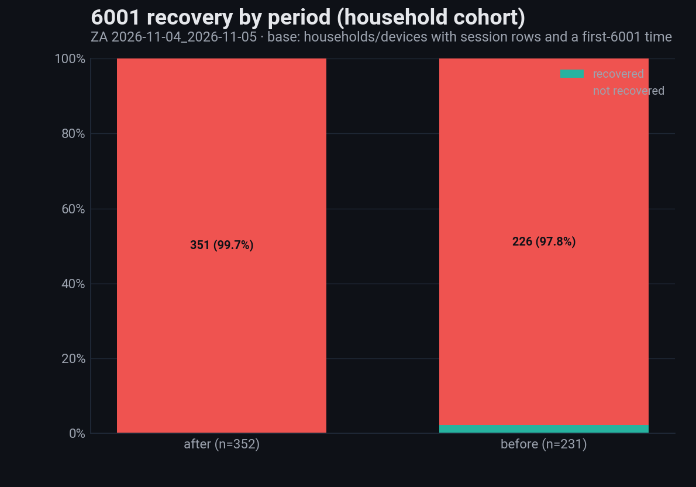
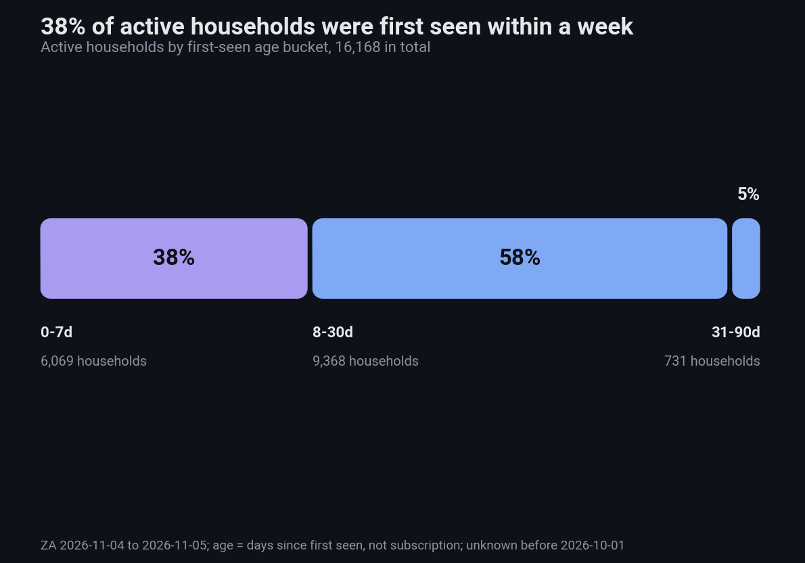
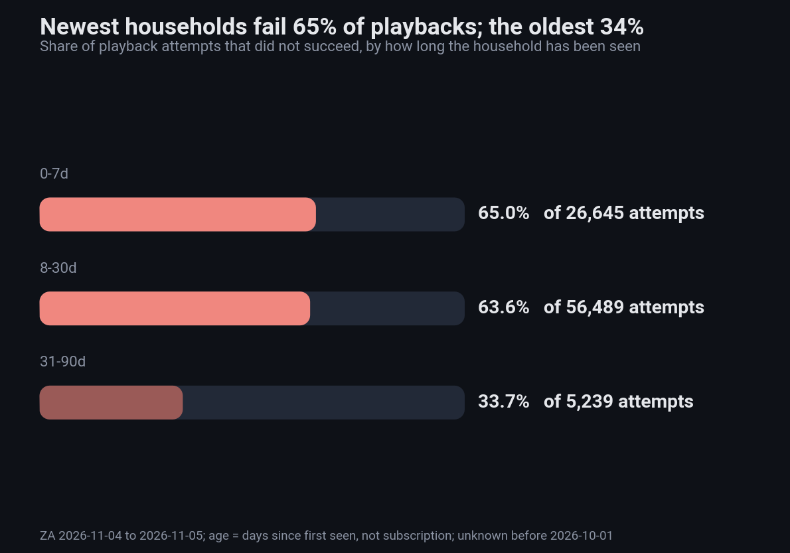
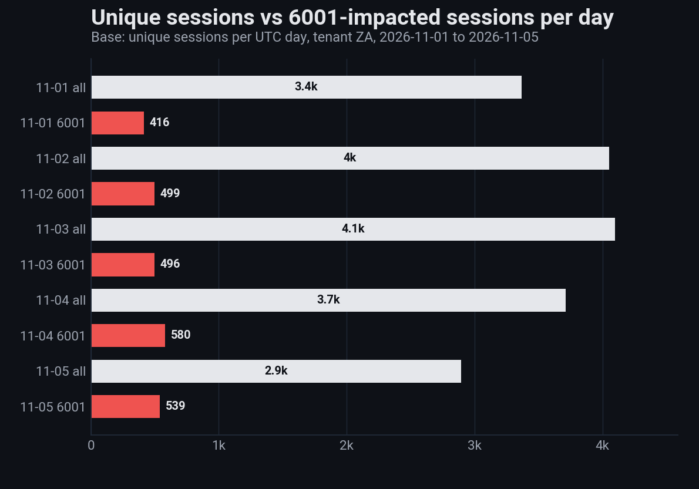
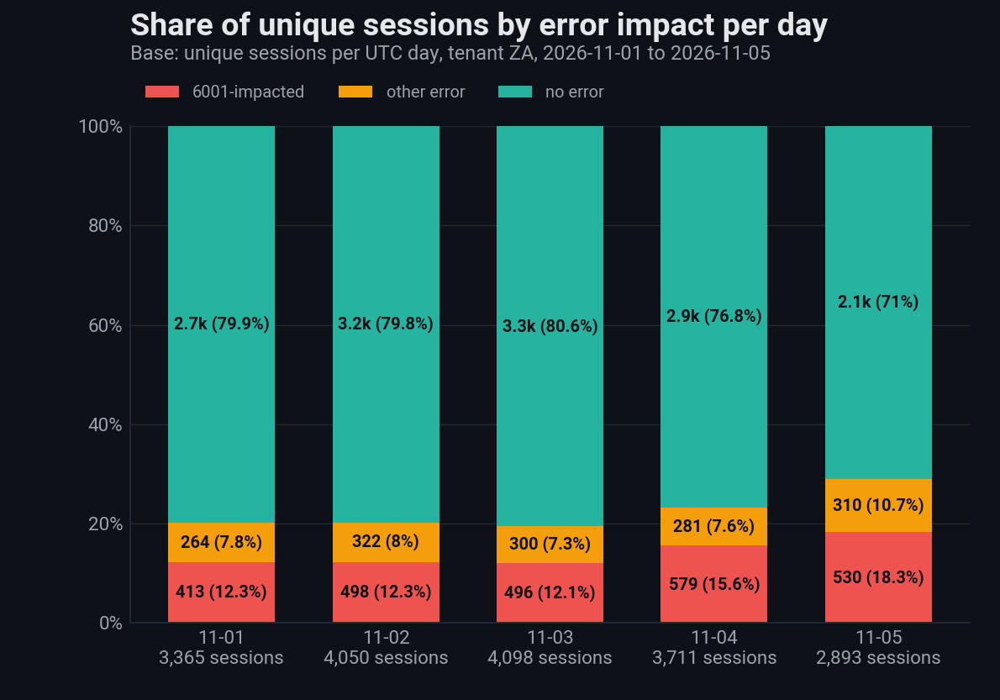

# ZA Shaka 6001 — before/after the 2026-11-04 app upgrade (findings)

Source: local run of `scripts/run_analysis.py --start-date 2026-11-04 --end-date 2026-11-05` (no Athena queries), outputs in `output/ZA/` (gitignored). Tenant ZA, day basis IST. Upgrade window
2026-11-04 16:30–17:00 IST; before = `v2026.10.27.01`, after = `v2026.11.03.02` (`config/analysis.yaml`).

## 1. Volume — raw counts rise, hourly rate does not

| Base: 6001 events | Events | Approx. span (IST) | Hours | Events/hour |
|---|---|---|---|---|
| Before | 264 | 11-04 05:53 → 16:30 | ~10.6 | ~25 |
| After | 850 | 11-04 17:00 → 11-06 04:21 | ~35.3 | ~24 |

The raw rise (264 → 850) is mostly the longer after window. Spans come from the first/last event timestamps in the enriched file, so they are approximate and exclude the 30-minute window. Before
covers daytime only and after includes the evening peak and night, so the hourly rates are not a like-for-like comparison. No upgrade effect on 6001 volume is visible from this data.

## 2. Webview vs non-webview (base: 6001 events)

| Period | Webview | Non-webview |
|---|---|---|
| Before (264) | 258 (97.7%) | 6 (2.3%) |
| After (850) | 803 (94.5%) | 47 (5.5%) |

Daily webview share, as a pp change vs the before-period share (day 0 = 11-04, day 2 = 11-06, which is partial):

Non-webview 6001s grew from 6 to 47 events (5 → 11 devices). Counts are small, so the 3.3 pp shift is indicative only. Eventdata `iswebview` disagrees with the user-agent `wv` flag on 28 of 850 rows
where both are known.

## 3. Models

After the upgrade the top models are SM-A065F (116 events, 45 devices, 13.7%) and SM-A055F (103 events, 44 devices, 12.1%). SM-A055F's share is unchanged; SM-A065F gained 3.0 pp. The top models are
the common Samsung A-series phones, so the list mostly mirrors the device base. "K (device masked - UA reduction)" is a masked bucket and not a single model.

## 4. DRM (base: devices with 6001)

`drmsupported` is true on 1 device, false on 365 and unknown on 218 (37%). It is unknown because the before-period app version does not send the field (empty on all 264 before rows). DRM cannot be
compared before vs after.

## 5. Recovery (base: households with session rows and a first 6001)

| Period | Households | Recovered | Rate |
|---|---|---|---|
| Before | 231 | 5 | 2.2% |
| After | 352 | 1 | 0.3% |

All 6 recoveries were cross-session on the same day; none were same-session. The webview split is 5 of 567 (0.9%) vs 1 of 16 (6.3%) non-webview. With 6 recoveries in total, no rate comparison is
reliable.

## 6. Guest login redirects (base: redirect rows / distinct GUEST ids)

| Period | Redirect rows | Guest ids | Rows per guest | Ended journey |
|---|---|---|---|---|
| Before | 42 | 20 | 2.1 | 23.8% |
| After | 846 | 442 | 1.9 | 27.3% |

Every guest has a debug-event match and 99% are webview. None had a 6001 before the redirect. GUEST ids are per-install, not households. Redirects ramp up after the upgrade, but the before period is
short, so compare per hour before drawing conclusions. The daily file also contains a partial 2026-11-06 (101 rows).

## 7. User tenure (base: households, local session history from 2026-10-01)

 

16,168 households: 0–7d 6,069, 8–30d 9,368, 31–90d 731, and none beyond 90 days. Session success rates are 35.0%, 36.4% and 66.3%. This is **not** a customer-age effect. Local history starts at
2026-10-01 and session volume ramps from about 160 rows to about 6,000 a day, so "first seen" mostly reflects when a household entered the sample. The 31–90d bucket is also left-censored (31
households). A valid tenure view needs a full-history first-seen query, which would need an approved Athena scan.

## 8. Session error impact, 2026-11-01 to 11-05 (base: unique sessions per UTC day, ZA)

Unique session = distinct `sessionId` in the day's `unified_sessions` extract. Error-impacted = the `sessionid` appears in a `PLAYER_ERROR` event of any code; 6001-impacted = at least one 6001 event.
A session with 6001 plus another error counts as 6001 only. Percentages use only error sessions found in that day's session file, so they cannot exceed 100%.

| UTC day | Unique sessions | Error sessions | 6001 sessions | % of unique with error | % of unique with 6001 | % of error sessions that are 6001 |
|---|---|---|---|---|---|---|
| 11-01 | 3,365 | 683 | 416 | 20.1% | 12.3% | 60.9% |
| 11-02 | 4,050 | 823 | 499 | 20.3% | 12.3% | 60.6% |
| 11-03 | 4,098 | 800 | 496 | 19.4% | 12.1% | 62.0% |
| 11-04 | 3,711 | 863 | 580 | 23.2% | 15.6% | 67.2% |
| 11-05 | 2,893 | 859 | 539 | 29.0% | 18.3% | 62.8% |
| All | 18,112 | 4,028 | 2,530 | 22.1% | 13.9% | 62.8% |

  

- The 6001 share of all sessions was steady at about 12% on 11-01 to 11-03, then 15.6% on 11-04 (the upgrade day) and 18.3% on 11-05.
- Part of the rise is a smaller denominator: unique sessions fell from about 4,100 to 2,893 on 11-05 while 6001 sessions stayed near 540. The 11-05 session file was fetched at about 07:00 UTC on
  11-06, so ingest lag may explain the drop. Treat the 11-05 percentages as provisional until that day is re-fetched.
- 6001 is the largest single error: about 61–67% of error-impacted sessions every day. The 11-04 share rose to 67.2% while the non-6001 error count stayed near 280–320.
- 35 of 4,028 error sessions (14 of the 2,530 6001 sessions) are not in any session file; they are excluded from the percentages but included in the counts.

## Caveats

- Sections 1–7 cover 2026-11-04 to 11-05 only; the before period is under one day. Section 8 covers 11-01 to 11-05 on a UTC day basis.
- About 46,000 session rows have no `event_start` and are dated by file day.
- Eight commits skipped the automatic code review because the diff exceeded the cap (SU-4, SU-6, SU-9, SU-10, SU-12, `drm-fix`, SU-14, SU-15).
